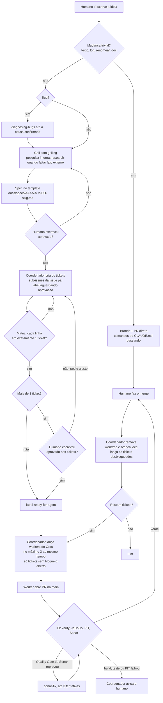
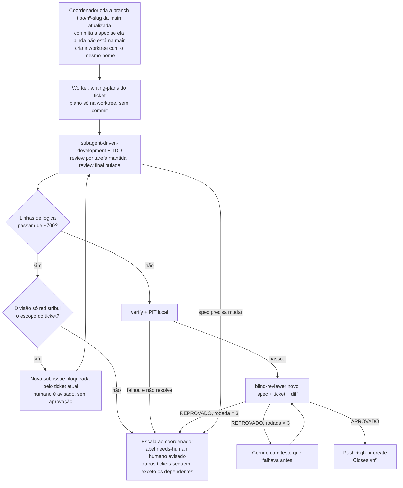

# dev-flow

O humano participa da ideia, da spec, da validação dos tickets e de cada merge. Você é o **coordenador**: conduz o grill, escreve a spec, cria os tickets e lança um worker do Orca por ticket. Siga as etapas na ordem e não pule nenhuma. **Nenhum agente faz merge**, nem você, nem os workers: o merge é sempre do humano.

## Fluxos

### Fluxo principal


### Execução de um ticket (dentro do worker)


## Pré-requisitos
Confira antes da etapa 3 (execução):
- **Orca rodando.** Rode `orca status --json` e confira `result.app.running: true` e `result.runtime.reachable: true`. Se o Orca estiver indisponível (comando falha, app fechado, runtime desconectado), avise o humano e pare. **Não execute o ticket na sua própria sessão.**
- **Configuração do GitHub (feita pelo humano no painel):** branch protection na `main` (exigir PR e CI verde) e "Automatically delete head branches". Se faltar, avise o humano; você não altera essas configurações.

## 0. Trivial e bug
- **Toda implementação** (feature, bug, refactor, mudança de comportamento) passa por esta skill.
- **Única exceção: mudança trivial** (texto, log, renomear, ajuste de doc). Nesse caso crie uma branch e abra o PR direto, com os comandos da seção "Comandos" do CLAUDE.md passando. Não há spec nem tickets. O merge continua sendo do humano.
- Qualquer coisa que não seja trivial segue o fluxo completo, a partir da etapa 1.
- **Bug:** antes da etapa 1, use a skill **diagnosing-bugs** até ter um loop que reproduz o sintoma e a causa confirmada. A spec registra a causa, e a Matriz de testes inclui o teste de regressão.

## 1. Grill e spec
- Entreviste o humano com a skill **grilling**. **Não use `superpowers:brainstorming`.** (A `grill-me` só pode ser chamada pelo humano; ela delega para a `grilling`.)
- Faça a pesquisa interna (código, schema, migrations) dentro do grill. Use a skill **research** só quando faltar um fato externo (documentação, API).
- Escreva a spec a partir de [spec-template.md](spec-template.md), em `docs/specs/AAAA-MM-DD-<slug>.md`.
- Todo fluxo tem fluxograma Mermaid, inclusive os caminhos de erro. Toda decisão cara de desfazer vai na tabela de decisões.
- Cada critério de aceite precisa ser testável. A spec tem Matriz de testes (ver `.claude/rules/testing.md`).
- Se a feature cria 3+ classes, um módulo novo ou muda uma interface pública, preencha a seção **Design estrutural**:
  - Antes de propor classes, leia o código existente da área (Grep/Glob) só para reaproveitar o que já funciona e evitar duplicação.
  - O projeto ainda é novo: **o código existente não é precedente de design**. Um pattern que já aparece no projeto precisa da mesma justificativa que um pattern novo.
  - **Comece sempre pela solução mais simples** que atende aos critérios de aceite (classes e métodos diretos, sem abstrações extras).
  - Use a skill **codebase-design** como vocabulário (módulos profundos, interfaces pequenas).
  - Só proponha um pattern se a solução simples falhar num caso concreto desta spec. Nesse caso, preencha a **Comparação** do template e mostre ao humano no grill, antes da aprovação.
  - Sem aprovação explícita do humano para o pattern, fica a solução simples.
- **Pare aqui até o humano escrever "aprovado".** Silêncio não é aprovação. Nada é feito depois da spec sem esse "aprovado". Ao aprovar, mude `Status` para `aprovada (AAAA-MM-DD)`.
- **A spec aprovada é imutável.** Se um worker precisar mudá-la, ele escala (etapa 3). O humano decide a alteração, e você aplica a mesma alteração em todas as branches de ticket abertas.

## 2. Tickets
Cada ticket é uma **sub-issue da issue pai** da feature. Se a feature ainda não tem issue pai, crie-a antes (`gh issue create`, com o objetivo e o link da spec). Sem trechos de código no ticket.

### Como cortar
Não chame a skill `to-tickets`; as regras dela estão aqui:
- **Fatia vertical:** cada ticket funciona e é testável sozinho (do endpoint ou da tool até o banco, o que o CA pedir). Nada de ticket "só entidades" ou "só testes".
- **Prefactor primeiro:** se uma refatoração prepara o terreno, ela é um ticket próprio, do tipo `refactor`, e bloqueia os que dependem dela.
- **Refactor largo segue expand–contract:** um ticket adiciona o novo ao lado do antigo, os seguintes migram os usos, o último remove o antigo. A `main` fica verde entre um e outro.
- **Tamanho:** estimativa de **~500 linhas de lógica** por ticket, contando só `src/main/java` (sem testes, docs, json, yaml, sql). Acima de ~700 o ticket precisa ser dividido. **Nunca** remova ou comprima código para caber no limite.
- **Dependências:** ticket bloqueado só começa depois do **merge** de todos os bloqueadores (nada de stacked PR). Dois tickets que precisam do mesmo arquivo compartilhado não reservável (seed, `application.yaml`, seção de estrutura do CLAUDE.md) não são paralelos: um bloqueia o outro.
- **Migration:** reserve uma versão de migration Flyway distinta (`V7`, `V8`, ...) para cada ticket que cria schema, olhando a maior versão em `src/main/resources/db/migration` e nas outras reservas abertas.

### Template do ticket (corpo da sub-issue)
```markdown
## Contexto
Spec: docs/specs/<arquivo>.md. Issue pai: #<nº>. <problema de origem em 1 a 3 linhas>

## Cenário atual
<o que o sistema faz hoje nesta área>

## Cenário desejado
<o que passa a fazer quando este ticket for mergeado>

## Rastreabilidade
| RF/RN/CA | IDs da matriz |
|---|---|
| CA01, RN03 | T01, T02 |

## Alterações previstas
- `Classe.metodo(...)`: <o que muda, sem código>

## Análise de impacto
<banco, APIs, outras classes e tickets afetados>

## Dependências
Bloqueado por: #<nº> (vínculo `blocked-by` nativo; escreva aqui só se o vínculo nativo falhar)

## Tamanho
~<N> linhas de lógica em src/main/java

## Migration
<versão reservada, ex.: V7> ou "nenhuma"
```

### Checagem antes de publicar
- Monte a tabela linha da matriz → ticket. **Cada linha da matriz de testes pertence a exatamente um ticket.** Linha sem ticket ou em dois tickets: corrija os tickets antes de publicar. Não publique enquanto houver.
- Confira as versões de migration reservadas (nenhuma repetida) e os bloqueios por arquivo compartilhado.

### Publicar
0. **Labels** `aguardando-aprovacao`, `ready-for-agent` e `needs-human`: confira com `gh label list` e crie os que faltarem (o `needs-human` pode já existir, criado pelo `sonar-fix.yml`):
   ```bash
   gh label create aguardando-aprovacao --description "Ticket aguardando aprovação do humano"
   gh label create ready-for-agent --description "Ticket liberado para um worker"
   gh label create needs-human --description "Precisa de decisão humana"
   ```
1. Crie cada sub-issue com o label `aguardando-aprovacao` e adicione-a ao Projects **Kanban** (`gh issue edit <nº> --add-project "Kanban"`; se o token não tiver o escopo `project`, avise o humano e siga):
   ```bash
   gh issue create --title "<tipo>: <título curto>" --body-file <arquivo-do-corpo>.md --label aguardando-aprovacao
   ```
2. Vincule à issue pai e aos bloqueadores pela API REST do GitHub (`gh api`):
   - Sub-issue: `POST repos/{owner}/{repo}/issues/<nº do pai>/sub_issues` com o campo `sub_issue_id`.
   - Bloqueio: o endpoint de dependências da issue, `POST repos/{owner}/{repo}/issues/<nº do ticket>/dependencies/blocked_by`, com o campo `issue_id` do bloqueador.
   - Esses campos recebem o **`id` interno** da issue, não o número: `gh api repos/{owner}/{repo}/issues/<nº> --jq .id`. Passe-o como inteiro (`-F`).
3. Confirme os vínculos: `gh api repos/{owner}/{repo}/issues/<nº>/parent --jq .number` deve devolver o pai, e `gh api repos/{owner}/{repo}/issues/<nº>/dependencies/blocked_by --jq '.[].number'` os bloqueadores. Se o vínculo nativo falhar, escreva os bloqueadores na seção `## Dependências` do corpo e avise o humano.
4. Aprovação:
   - **Um ticket só:** a aprovação da spec basta. Troque o label para `ready-for-agent` (`gh issue edit <nº> --remove-label aguardando-aprovacao --add-label ready-for-agent`).
   - **Mais de um ticket:** mostre a lista ao humano (título, tamanho, bloqueios, linhas da matriz) e **pare até ele escrever "aprovado" para os tickets**. Pedido de ajuste: volte ao corte. Com o "aprovado", troque o label de todos para `ready-for-agent`.

## 3. Execução
Todo ticket é executado por um **worker do Orca**, em sessão e worktree próprias, **inclusive quando a feature tem um ticket só**. Carregue a skill **orchestration** e siga os comandos da versão instalada (as flags mudam entre versões).

Você continua sendo o coordenador (a sessão do grill, da spec e dos tickets). O estado mora no GitHub: uma sessão nova consegue retomar a coordenação lendo só a issue pai e as sub-issues (`gh issue view <pai>`, labels, `blocked-by`, PRs abertos).

### Modelos
Opus onde um erro custa caro (decisão e review final); volume de código no Sonnet ou no Haiku, poupando o limite da assinatura com até 3 workers.

| Papel | Modelo | Como |
|---|---|---|
| Coordenador (grill, spec, tickets) | Opus, effort alto | modelo da sessão; se ela estiver em outro, avise o humano antes do grill |
| Worker (plano do ticket + coordenação do subagent-driven) | Sonnet | `--model claude-sonnet-5-5 --effort high` ao lançar pelo Orca |
| Implementadores do subagent-driven | o mais barato que dá conta: Haiku para tarefa mecânica, Sonnet para integração entre arquivos | regra de escolha de modelo da própria skill |
| Reviews por tarefa | Sonnet | idem |
| `blind-reviewer` | Opus | fixado no frontmatter do agente (`model: opus`) |
| `sonar-fix` (CI) | definido no `sonar-fix.yml` | fora desta skill |

### Fila
- **No máximo 3 workers ao mesmo tempo.** Os demais tickets esperam na fila.
- Só entra na fila ticket `ready-for-agent` sem bloqueador aberto (todos os bloqueadores mergeados).

### Para cada ticket que sai da fila
1. Atualize a `main`: `git fetch origin` e parta de `origin/main`.
2. Crie a branch `<tipo>/<nº da sub-issue>-<slug-curto>`, com tipo `feat`, `fix` ou `refactor` (prefactor). Ex.: `feat/21-carrinho-remover-item`.
3. Se a spec ainda não está na `main`, copie o arquivo da spec aprovada (da sua working tree) para a branch e commite-o (cópia idêntica em cada branch de ticket; não conflita). Commits usam `Refs #<nº>`.
4. Crie a worktree do Orca com o **mesmo nome** da branch, a partir dela.
5. Lance o worker com o prompt abaixo, preenchido, e o modelo da seção "Modelos" (`--model claude-sonnet-5-5 --effort high` no comando do Orca que cria a worktree ou lança o agente).
6. Acompanhe as mensagens do worker pelo Orca: perguntas (`ask`, que você responde com `reply`) e o `worker_done` final. Escalação e aviso de divisão chegam como `ask` (ou como `worker_done` com status `escalado` e o motivo). Responda você o que a spec e o ticket respondem; o que só o humano decide, pergunte a ele.

### Divisão de ticket
Quando o worker avisa que o ticket passa de ~700 linhas de lógica:
- **A divisão só redistribui o escopo** (mesmos CA/RF, linhas da matriz e alterações previstas do ticket original): crie a sub-issue nova com o template, `ready-for-agent`, **bloqueada pelo ticket atual**, e avise o humano. Não precisa de aprovação. A sub-issue nova recebe só o escopo **ainda não escrito**; edite o corpo do ticket atual para refletir o que ficou nele. Código já pronto não é removido.
- **A divisão traz escopo novo:** é escalação (abaixo).

### Escalação
O worker escala quando: a review cega reprova na 3ª rodada, `verify` ou PIT não passam e ele não resolve, a spec precisa mudar, ou a divisão traria escopo novo. Ao receber:
1. Ponha o label `needs-human` na sub-issue (`gh issue edit <nº> --add-label needs-human`).
2. Avise o humano com o motivo e o relatório do worker.
3. Deixe seguir os tickets que não dependem do travado. Os dependentes esperam.
4. Se o humano aprovar uma mudança na spec, aplique a mesma alteração em todas as branches de ticket abertas.

### Prompt do worker
```
Você é um worker do dev-flow. Execute SOMENTE o ticket #<nº> (<link da sub-issue>).
Spec aprovada: docs/specs/<arquivo>.md (imutável).
Branch e worktree: <tipo>/<nº>-<slug>. Commits com "Refs #<nº>".

Escopo = o ticket: as alterações previstas, os RF/CA e as linhas da matriz atribuídas a ele.
Mudança de comportamento fora dele = pergunte ao coordenador pelo Orca, não decida sozinho.

Passos, na ordem:
1. superpowers:writing-plans para este ticket. O plano fica só na worktree: não commite.
2. superpowers:subagent-driven-development com superpowers:test-driven-development em cada tarefa.
   Mantenha as reviews por tarefa. NÃO rode a review final do subagent-driven-development
   nem superpowers:finishing-a-development-branch.
   Testes a partir das linhas da matriz deste ticket, seguindo .claude/rules/testing.md.
3. Depois de CADA tarefa, meça as linhas de lógica (some só a 1ª coluna, a de linhas adicionadas):
   git diff --numstat origin/main...HEAD -- src/main/java
   Se a soma passar de ~700: pare num ponto coerente (tarefa
   concluída, testes verdes) e avise o coordenador por ask, dizendo o que ainda não foi escrito.
   Esse resto vai para a sub-issue nova. Nunca remova nem comprima código para caber.
   Depois da resposta do coordenador, não resta tarefa deste ticket a implementar (o resto foi
   para a sub-issue nova): siga para o passo 4 com o que já foi escrito.
4. Rode ./mvnw clean verify e ./mvnw test-compile org.pitest:pitest-maven:mutationCoverage.
   Se falhar e você não resolver: escale.
5. Chame um subagente blind-reviewer NOVO com a mensagem exata, e nada mais:
   Spec: docs/specs/<arquivo>.md. Ticket: #<nº>. Diff: git diff origin/main...HEAD.
   Corrija todo BLOQUEANTE e IMPORTANTE, cada correção com um teste que falhava antes,
   e chame outro blind-reviewer novo. Limite de 3 rodadas; reprovado na 3ª = escale.
6. Com a review aprovada: push da branch e gh pr create na main, usando a skill pr. A descrição traz:
   - Closes #<nº>
   - link da spec
   - tabela RF/CA -> testes
   - alterações realizadas (classes e métodos)
   - previsto x realizado, com a justificativa de cada desvio
   - resumo da review cega (rodadas, achados, correções)
   - linhas de lógica medidas
7. Envie worker_done com o link do PR, os arquivos modificados e as pendências.

Escale ao coordenador (por ask pelo Orca, com o motivo; se não puder continuar, worker_done
com status "escalado") quando: a review reprovar na 3ª rodada, verify ou PIT não passarem,
a spec precisar mudar, ou a divisão trouxer escopo novo.

Siga as Proibições e a validação de Dependências do CLAUDE.md.
NUNCA faça merge.
```

## 4. Depois do PR
- **Quality Gate do Sonar reprovado:** o `sonar-fix` assume no CI (até 3 tentativas), como hoje. Não interfira.
- **Falha de build, teste ou PIT no CI:** não há corretor automático. Avise o humano com o link do run.
- **CI verde:** o humano faz o merge. Nenhum agente faz merge.
- **Depois do merge:** remova a worktree do Orca e a branch local do ticket (a remota some pelo auto-delete), volte à fila e lance os tickets que ficaram desbloqueados. Sem tickets restantes, a feature terminou.
