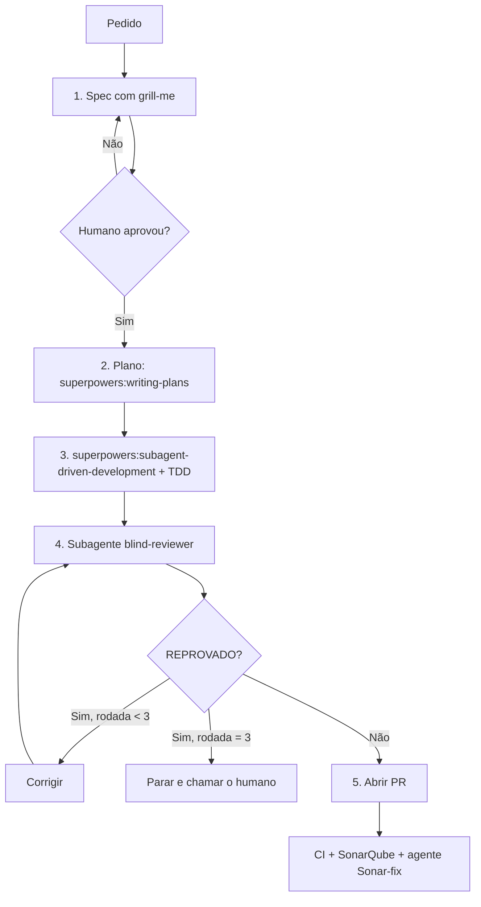

# spec-flow

O humano participa só da spec. Siga as etapas na ordem e não pule nenhuma.

## 1. Spec (com o humano)
- Use a skill **grill-me**. **Não use `superpowers:brainstorming`**.
- Escreva a spec a partir de [spec-template.md](spec-template.md), em `docs/specs/AAAA-MM-DD-<slug>.md`.
- Todo fluxo tem fluxograma Mermaid (com caminhos de erro). Toda decisão cara de desfazer vai na tabela de decisões.
- Cada critério de aceite precisa ser testável.
- Se a feature cria 3+ classes, um módulo novo ou muda uma interface pública, preencha a seção **Design estrutural**:
  - Antes de propor classes, leia o código existente da área (Grep/Glob) só para reaproveitar o que já funciona e evitar duplicação.
  - O projeto ainda é novo: **o código existente não é precedente de design**. Um pattern que já aparece no projeto precisa da mesma justificativa que um pattern novo.
  - **Comece sempre pela solução mais simples** que atende aos critérios de aceite (classes e métodos diretos, sem abstrações extras).
  - Use a skill **codebase-design** como vocabulário (módulos profundos, interfaces pequenas).
  - Só proponha um pattern se a solução simples falhar num caso concreto desta spec. Nesse caso, preencha a **Comparação** do template e mostre ao humano no grill-me, antes da aprovação.
  - Sem aprovação explícita do humano para o pattern, fica a solução simples.
- **Pare aqui até o humano escrever "aprovado".** Silêncio não é aprovação. Ao aprovar, mude `Status` para `aprovada (data)`.

## 2. Plano
- `superpowers:writing-plans` a partir da spec aprovada, salvo em `docs/plans/<slug>.md`.
- Cada tarefa cita os CA/RN que atende.
- Se o plano precisar contrariar a spec, pare e pergunte.

## 3. Implementação
- `superpowers:subagent-driven-development` + `superpowers:test-driven-development`.
- Branch `feat/<slug>` ou `fix/<slug>`.
- Os comandos do CLAUDE.md precisam passar ao fim de cada tarefa.
- Os testes são do implementador, escritos antes do código, a partir da **Matriz de testes** da spec e seguindo `.claude/rules/testing.md`. Cada teste corresponde a um ID da matriz (T01, T02...). Caminho descoberto que não está na matriz: adicione à matriz e avise o humano no PR.
- Toda dependência adicionada passa pela validação da seção "Dependências" do CLAUDE.md **antes** de ser declarada no arquivo de build. Dependência que não está na spec aprovada = pare e pergunte.

## 4. Review cega
- Delegue ao subagente **blind-reviewer** com uma mensagem contendo **somente**:
  > Spec: `docs/specs/<arquivo>.md`. Diff: `git diff origin/main...HEAD`.
- Não inclua plano, resumo da implementação, justificativas nem trechos desta conversa.
- Corrija todos os BLOQUEANTE e IMPORTANTE, cada correção com um teste que falhava antes.
- Após cada correção, chame um blind-reviewer **novo**. Limite de 3 rodadas; depois disso, mostre o relatório ao humano e pare.
- Salve o relatório final em `docs/reviews/<slug>.md`.

## 5. Pull Request
`gh pr create` com uma descrição que contenha:
- link para a spec;
- tabela CA → teste(s) que o cobrem;
- resumo da review cega (rodadas, achados, correções);
- o que ficou deliberadamente de fora.

Depois disso, o CI e o agente Sonar-fix assumem. O merge é sempre do humano.
