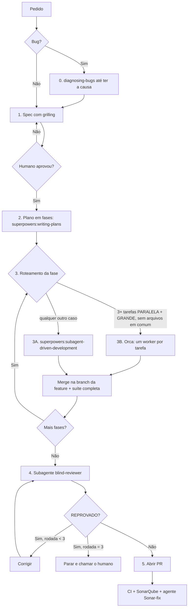

# spec-flow

O humano participa só da spec. Siga as etapas na ordem e não pule nenhuma.



## 0. Bug (só quando for bug)
- Use a skill **diagnosing-bugs** até ter um loop que reproduz o sintoma e a causa confirmada.
- A correção segue o fluxo a partir da etapa 1. A spec registra a causa, e a Matriz de testes inclui o teste de regressão.
- Mudança trivial (texto, log, renomear) não passa por este fluxo; os comandos do CLAUDE.md continuam obrigatórios.

## 1. Spec (com o humano)
- Use a skill **grilling** para entrevistar o humano. **Não use `superpowers:brainstorming`**. (A `grill-me` só pode ser chamada pelo humano; ela delega para a `grilling`.)
- Escreva a spec a partir de [spec-template.md](spec-template.md), em `docs/specs/AAAA-MM-DD-<slug>.md`.
- Todo fluxo tem fluxograma Mermaid (com caminhos de erro). Toda decisão cara de desfazer vai na tabela de decisões.
- Cada critério de aceite precisa ser testável.
- Se a feature cria 3+ classes, um módulo novo ou muda uma interface pública, preencha a seção **Design estrutural**:
  - Antes de propor classes, leia o código existente da área (Grep/Glob) só para reaproveitar o que já funciona e evitar duplicação.
  - O projeto ainda é novo: **o código existente não é precedente de design**. Um pattern que já aparece no projeto precisa da mesma justificativa que um pattern novo.
  - **Comece sempre pela solução mais simples** que atende aos critérios de aceite (classes e métodos diretos, sem abstrações extras).
  - Use a skill **codebase-design** como vocabulário (módulos profundos, interfaces pequenas).
  - Só proponha um pattern se a solução simples falhar num caso concreto desta spec. Nesse caso, preencha a **Comparação** do template e mostre ao humano no grilling, antes da aprovação.
  - Sem aprovação explícita do humano para o pattern, fica a solução simples.
- **Pare aqui até o humano escrever "aprovado".** Silêncio não é aprovação. Ao aprovar, mude `Status` para `aprovada (data)`.

## 2. Plano
- `superpowers:writing-plans` a partir da spec aprovada, salvo em `docs/plans/<slug>.md`.
- Se o plano precisar contrariar a spec, pare e pergunte.
- Cada tarefa leva, além do que o writing-plans pede:

| Campo | Conteúdo |
|---|---|
| ID | T1, T2, ... |
| CA/RN | os critérios e regras da spec que a tarefa atende |
| Arquivos permitidos / proibidos | escopo explícito |
| Dependências | IDs das tarefas de que depende |
| Tipo | `SEQUENCIAL` ou `PARALELA` |
| Tamanho | `PEQUENA` (poucos arquivos, poucos minutos de agente) ou `GRANDE` |

- Organize as tarefas em **fases**: uma fase só depende de fases anteriores. Fundação compartilhada (interfaces, contratos, DTOs) fica numa fase sequencial anterior às tarefas que a usam. Remoção de código antigo e integração final ficam numa fase sequencial no fim.
- No fim do plano, inclua: arquivos tocados por mais de uma tarefa, ordem de merge e a **rota de cada fase** (etapa 3) com o motivo.
- O plano não passa por aprovação humana: siga para a etapa 3.

## 3. Implementação (rota decidida por fase)

| Situação da fase | Rota |
|---|---|
| 3 ou mais tarefas `PARALELA` + `GRANDE`, sem arquivos em comum | **3B. Orca** |
| Qualquer outro caso: sequencial, poucas tarefas, tarefas pequenas, arquivos compartilhados | **3A. superpowers** |
| Na dúvida | 3A |

Vale para as duas rotas:
- Branch `feat/<slug>` ou `fix/<slug>`, criada antes da primeira fase. Todas as fases são integradas nela.
- Uma fase só começa depois que a anterior estiver integrada na branch e com a suíte completa passando.
- Os testes são do implementador, escritos antes do código, a partir da **Matriz de testes** da spec e seguindo `.claude/rules/testing.md`. Cada teste corresponde a um ID da matriz (T01, T02...). Caminho descoberto que não está na matriz: adicione à matriz e avise o humano no PR.
- Toda dependência adicionada passa pela validação da seção "Dependências" do CLAUDE.md **antes** de ser declarada no `pom.xml`. Dependência que não está na spec aprovada = pare e pergunte.
- Tarefa que alterou arquivo fora do escopo, sem justificativa, é reprovada.

### 3A. superpowers (sequencial ou pequeno)
- `superpowers:subagent-driven-development` com as tarefas da fase, na ordem do plano, e `superpowers:test-driven-development` em cada tarefa.
- As revisões por tarefa do subagent-driven-development continuam valendo.
- Ao fim da **última** fase, **não** rode a revisão final do subagent-driven-development nem o `superpowers:finishing-a-development-branch`: a etapa 4 substitui os dois, e o merge é do humano.

### 3B. Orca (grande e paralelo)
- Carregue a skill **orchestration** e siga os comandos da versão instalada (as flags mudam entre versões). Antes de tudo, `orca status --json`.
- **Fallback:** se o Orca não estiver disponível ou a orquestração não estiver habilitada, registre isso e use 3A para a fase.
- Passos:
  1. Confirme que a fase anterior está commitada na branch da feature.
  2. Crie um run para a fase e uma task por tarefa, com a spec do worker abaixo.
  3. Lance um worker por tarefa, cada um numa worktree própria criada a partir da branch da feature.
  4. Acompanhe os eventos (`worker_done`, `escalation`, `question`) e responda perguntas e escalações. Decida você o que a spec e o plano respondem; o que só o humano pode decidir, pare e pergunte.
  5. Para cada `worker_done`: leia a saída, confira o diff da worktree contra os arquivos permitidos e o critério de aceite da tarefa. Reprovado: relance com o feedback. Reprovado 2 vezes: pare e chame o humano.
  6. Faça o merge das worktrees na branch da feature na ordem do plano, rodando a suíte completa depois de cada merge. Conflito trivial: resolva. Senão: pare e pergunte.
  7. Libere os workers.

#### Spec do worker
```
Você é um worker. Execute SOMENTE a tarefa <ID> do plano em docs/plans/<slug>.md.
A spec aprovada está em docs/specs/<arquivo>.md.

Arquivos permitidos: <lista>
Arquivos proibidos: <lista>
Critério de aceite: <CA/RN da tarefa>

- Use superpowers:executing-plans restrito a esta tarefa e superpowers:test-driven-development.
- Testes a partir da Matriz de testes da spec, seguindo .claude/rules/testing.md.
- Siga as Proibições e a validação de Dependências do CLAUDE.md.
- Rode os comandos de build e teste do CLAUDE.md antes de terminar.
- Não abra PR, não faça merge e não faça push.
- Se precisar alterar um arquivo fora do escopo ou tiver uma dúvida bloqueante, pergunte ao coordenador pelo Orca em vez de decidir sozinho.
- Ao terminar, envie worker_done com o resultado, o que foi feito, as pendências e os arquivos modificados.
```

## 4. Review cega
- Delegue ao subagente **blind-reviewer** com uma mensagem contendo **somente**:
  > Spec: `docs/specs/<arquivo>.md`. Diff: `git diff origin/main...HEAD`.
- Não inclua plano, resumo da implementação, justificativas nem trechos desta conversa.
- Corrija todos os BLOQUEANTE e IMPORTANTE, cada correção com um teste que falhava antes.
- Após cada correção, chame um blind-reviewer **novo**. Limite de 3 rodadas; depois disso, mostre o relatório ao humano e pare.
- Salve o relatório final em `docs/reviews/<slug>.md`.

## 5. Pull Request
`gh pr create`, usando a skill **pr** para o formato, com uma descrição que contenha também:
- link para a spec;
- tabela CA → teste(s) que o cobrem;
- rota de cada fase (superpowers ou Orca);
- resumo da review cega (rodadas, achados, correções);
- o que ficou deliberadamente de fora.

Depois disso, o CI e o agente Sonar-fix assumem. O merge é sempre do humano.
