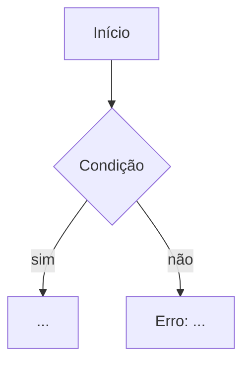
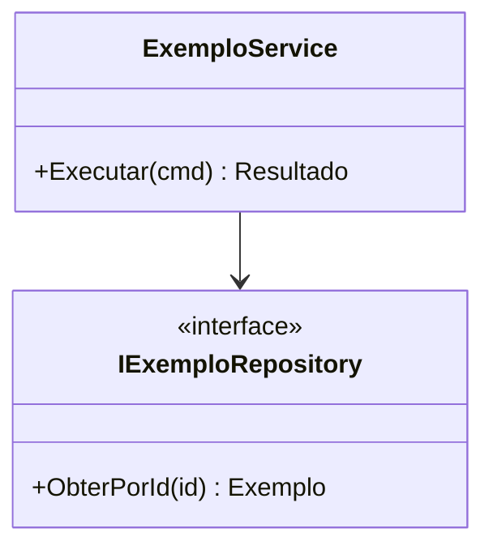
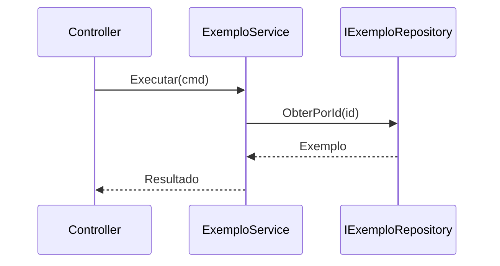

# <Título>
Status: rascunho | aprovada (AAAA-MM-DD)

## Problema e objetivo
<o que muda para o usuário e por quê, em 3 a 5 linhas>

## Fora do escopo
- ...

## Fluxos
<um fluxograma Mermaid por fluxo principal, incluindo os caminhos de erro>

## Design estrutural
<!-- Obrigatório quando a feature cria 3+ classes, um módulo novo ou muda uma interface pública. Caso contrário, escreva "N/A: <motivo>". -->

### Diagrama de classes (só o que é novo ou alterado)

### Sequência do fluxo principal

### Responsabilidades
| Classe/Interface | Responsabilidade (1 frase) | Camada | Nova ou existente |
|---|---|---|---|

### Patterns
Padrão: solução simples, sem pattern. Preencha o bloco abaixo **uma vez para cada** pattern proposto; se não houver nenhum, escreva "Nenhum: solução simples atende".
<!-- Um pattern só entra se a solução simples falhar num caso real desta spec. "Pode crescer no futuro" não conta. Vale também para patterns que já existem no projeto. -->

#### Pattern proposto: <nome>
- **Problema concreto:** <qual CA/RN a solução simples não atende bem, e por quê>
- **Caso que quebra a solução simples:** <cenário real desta spec>

| Critério | Solução simples | Com o pattern |
|---|---|---|
| Esboço | <3 a 10 linhas de código> | <3 a 10 linhas de código> |
| Nº de classes/interfaces | | |
| Facilidade de testar | | |
| Custo de mudar depois | | |
| O que piora | | |

- **Recomendação:** <simples / pattern> porque <motivo>
- **Aprovado pelo humano?** sim / não

### Dependências novas
| Pacote (nome exato) | Versão | Para que serve aqui | Existe no registro? | Publisher | Alternativa sem dependência |
|---|---|---|---|---|---|
<!-- Se não houver, escreva "Nenhuma". Toda dependência precisa passar pela validação do CLAUDE.md. -->

### Reuso
- Classes/utilitários existentes que serão reaproveitados: ...

## Decisões importantes
| # | Decisão | Opções consideradas | Escolha | Motivo | Reversível? |
|---|---------|---------------------|---------|--------|-------------|

## Regras de negócio
- RN01: ...

## Critérios de aceite (testáveis)
- CA01: Dado ..., quando ..., então ...

## Matriz de testes
<!-- Um caminho por linha (partição, limite, branch, erro ou transição). Dois testes da mesma partição não entram. Ver .claude/rules/testing.md -->
| ID | CA/RN | Caminho exercitado | Técnica (partição/limite/decisão/erro/estado) | Entrada → resultado esperado | Nível (unit/integração/e2e) |
|---|---|---|---|---|---|
| T01 | CA01 | | | | |

## Casos de borda e erros
- vazio / nulo / zero / limite / concorrência / timeout / permissão negada

## Impacto
- Banco/migrações, APIs públicas, segurança, performance, dados existentes

## Perguntas em aberto
- (precisa estar vazia para aprovar)
