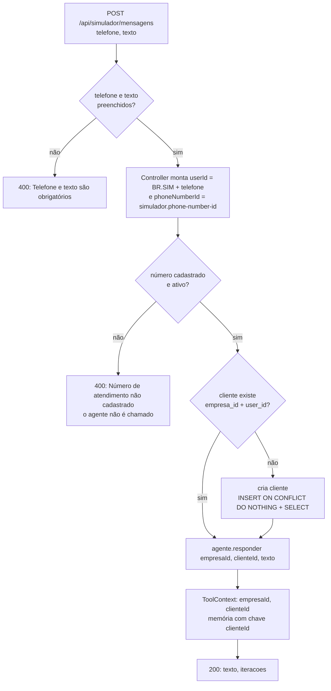
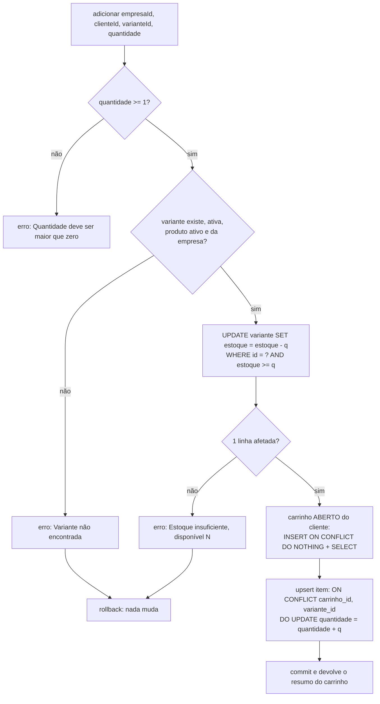
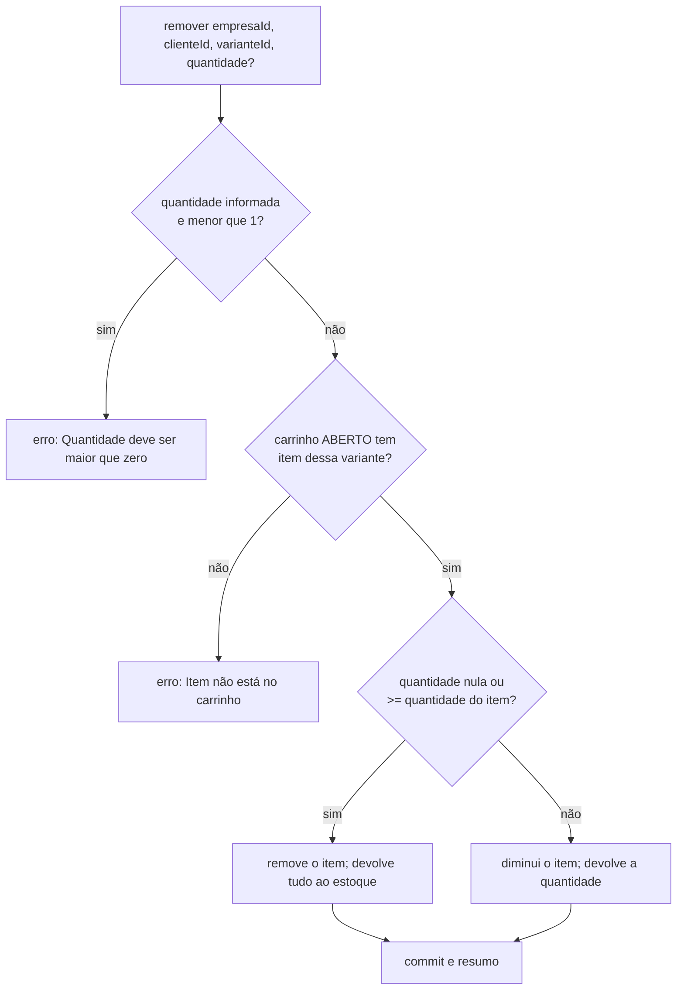
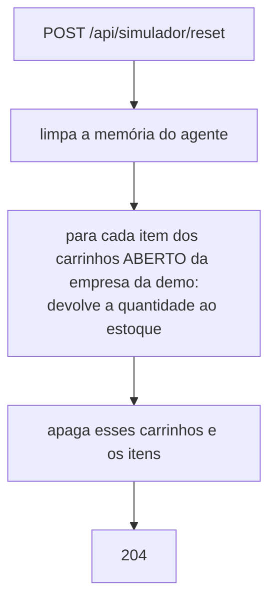
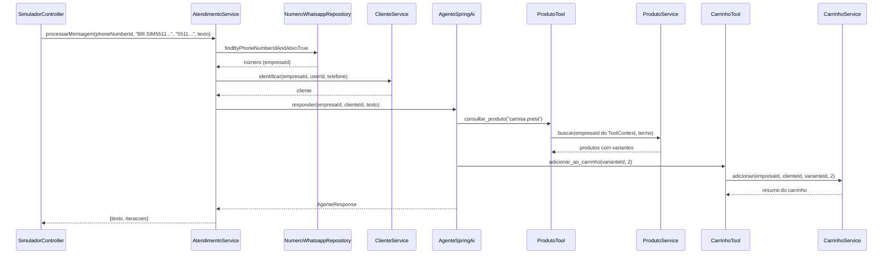

# Banco etapa 1: catálogo com variações e carrinho no PostgreSQL (Supabase)
Status: aprovada (2026-11-24); alteração RN16/CA18/T29/D12 (RLS) aprovada (2026-11-24)

## Problema e objetivo
A demo guarda o catálogo (`CatalogoMock`), o estoque (`EstoqueService`) e os carrinhos (`CarrinhoService`) em memória. Ao reiniciar a aplicação tudo se perde, e o estoque baixado por um carrinho em memória não tem garantia transacional. Esta etapa passa essas três peças para o PostgreSQL do Supabase, já no modelo multiempresa e com variações de produto (tamanho, cor, marca) que foi desenhado no brainstorming (artefato "Modelo do Banco Gestão Wpp", v3). Para o cliente no simulador, o comportamento continua o mesmo. Para o agente, as tools passam a trabalhar com variantes.

## Fora do escopo
- Tabelas `usuario`, `conversa`, `mensagem`, `pedido`, `item_pedido` e `endereco_cliente` (etapas 2 a 4).
- Login, painel, webhook real da Meta e envio de mensagens.
- Cadastro de produtos pelo sistema. Nesta etapa o catálogo só entra pelo seed.
- Unicidade do SKU por empresa, que entra com o cadastro de produtos. O SKU fica opcional e sem índice.
- Memória do agente no banco. Ela continua em memória, só muda a chave.
- Personalizar o prompt com os dados da empresa.
- Expiração de carrinho abandonado (status `ABANDONADO` existe no CHECK, mas nada o aplica ainda).
- Busca em SQL (`pg_trgm`/full text). A busca carrega o catálogo da empresa e pontua em Java.

## Fluxos

### Mensagem do simulador até o agente

### adicionar_ao_carrinho (uma transação)

### remover_do_carrinho (uma transação)

### Reiniciar demo

## Design estrutural

### Diagrama de classes (só o que é novo ou alterado)

```mermaid
classDiagram
    class NumeroWhatsapp { <<entity>> id; empresaId; phoneNumberId; ativo }
    class NumeroWhatsappRepository { <<interface>> +findByPhoneNumberIdAndAtivoTrue(String) Optional }
    class Cliente { <<entity>> id; empresaId; userId; telefone }
    class ClienteRepository { <<interface>> +inserirSeNaoExiste(...) ; +findByEmpresaIdAndUserId(...) }
    class ClienteService { +identificar(empresaId, userId, telefone) Cliente }
    class Produto { <<entity>> id; empresaId; nome; descricao; categoria; ativo; Set~Opcao~ opcoes; Set~Variante~ variantes }
    class Opcao { <<entity>> id; nome; posicao; Set~ValorOpcao~ valores }
    class ValorOpcao { <<entity>> id; opcao; valor; posicao }
    class Variante { <<entity>> id; produto; sku; preco; quantidadeEstoque; ativo; Set~ValorOpcao~ valores }
    class ProdutoRepository { <<interface JpaRepository>> +catalogoAtivo(empresaId) List~Produto~ }
    class VarianteRepository { <<interface JpaRepository>> +daEmpresa(varianteId, empresaId) Optional ; +baixarEstoque(id, q) int ; +devolverEstoque(id, q) int }
    class ProdutoService { +buscar(empresaId, termo) ResultadoBusca ; +consultarDisponibilidade(empresaId, varianteId) DisponibilidadeVariante ; +listarVariantes(empresaId) List }
    class Carrinho { <<entity>> id; empresaId; clienteId; status; List~ItemCarrinho~ itens }
    class ItemCarrinho { <<entity>> id; carrinho; variante; quantidade }
    class CarrinhoRepository { <<interface JpaRepository>> }
    class CarrinhoService { +adicionar(empresaId, clienteId, varianteId, q) ; +remover(...) ; +ver(clienteId) ; +reiniciarDemo(empresaId) }
    class AtendimentoService { +processarMensagem(phoneNumberId, userId, telefone, texto) AgenteResponse }
    class AgenteAtendimento { <<interface>> +responder(empresaId, clienteId, texto) AgenteResponse }
    class ContextoTool { +empresaId(ctx) UUID ; +clienteId(ctx) UUID }
    AtendimentoService --> NumeroWhatsappRepository
    AtendimentoService --> ClienteService
    AtendimentoService --> AgenteAtendimento
    ClienteService --> ClienteRepository
    ProdutoService --> ProdutoRepository
    ProdutoService --> VarianteRepository
    CarrinhoService --> CarrinhoRepository
    CarrinhoService --> VarianteRepository
    Produto "1" --> "*" Opcao
    Opcao "1" --> "*" ValorOpcao
    Produto "1" --> "*" Variante
    Variante "*" --> "*" ValorOpcao : variante_valor
    Carrinho "1" --> "*" ItemCarrinho
    ItemCarrinho "*" --> "1" Variante
```

### Sequência do fluxo principal (cliente pede "2 camisas pretas M")

### Responsabilidades
| Classe/Interface | Responsabilidade (1 frase) | Camada | Nova ou existente |
|---|---|---|---|
| `empresa/NumeroWhatsapp` + `NumeroWhatsappRepository` | Achar a empresa pelo `phone_number_id` ativo. | domínio / persistência | nova |
| `cliente/Cliente` + `ClienteRepository` + `ClienteService` | Achar ou criar o cliente por `(empresa_id, user_id)` sem duplicar sob concorrência. | domínio / persistência | nova |
| `produto/Produto`, `Opcao`, `ValorOpcao`, `Variante` | Entidades JPA do catálogo; `variante_valor` é o `@JoinTable` do `@ManyToMany` de `Variante.valores`. | persistência | `Produto` deixa de ser record; demais novas |
| `produto/ProdutoRepository` | Carregar o catálogo ativo de uma empresa com opções, valores e variantes. | persistência | substituída (passa a ser `JpaRepository`) |
| `produto/VarianteRepository` | Achar variante ativa da empresa; baixar e devolver estoque com `UPDATE` atômico nativo. | persistência | nova |
| `produto/ProdutoService` | Busca por pontuação (algoritmo atual + valores de opção), disponibilidade e lista de variantes para o simulador. | domínio | existente, alterada |
| `carrinho/Carrinho`, `ItemCarrinho` + `CarrinhoRepository` | Carrinho aberto do cliente e seus itens; upsert de item e criação do carrinho em SQL nativo. | persistência | `ItemCarrinho` deixa de ser record; demais novas |
| `carrinho/CarrinhoService` | Adicionar, remover, ver e reiniciar, cada operação numa transação. | domínio | existente, alterada |
| `atendimento/AtendimentoService` | Resolver número → empresa e cliente antes de chamar o agente. | aplicação | existente, alterada |
| `ai/AgenteAtendimento`, `AgenteSpringAi` | Receber `empresaId` e `clienteId`; memória e lock pela chave `clienteId`. | IA | existente, alterada |
| `ai/ContextoTool` | Ler `empresaId` e `clienteId` do `ToolContext` (sai o telefone). | IA | existente, alterada |
| `produto/ProdutoTool`, `carrinho/CarrinhoTool` | Mesmos 5 nomes de tool; parâmetros e respostas com `varianteId` e lista de variantes. | IA (adaptador) | existentes, alteradas |
| `produto/dto/` (`ConsultarProdutoResponse`, `ProdutoResponse`, `VarianteResponse`, `ConsultarEstoqueResponse`) e `carrinho/dto/` (`CarrinhoResponse`, `ItemCarrinhoResponse`) | Respostas das tools de cada domínio. | IA (adaptador) | movidas de `ai/dto/`; `VarianteResponse` nova |
| `simulador/SimuladorController` + `index.html` | Montar `userId` e `phoneNumberId` da demo; estado lista variantes; reset chama `reiniciarDemo`. | canal | existentes, alteradas |
| `CatalogoMock`, `ProdutoRepositoryEmMemoria`, `EstoqueService` | Removidas: dados vão para o seed e o estoque para `variante`. | — | removidas |

### Organização por domínio (exigência do humano)
Cada classe fica na pasta do seu domínio, sob `app.gestaoIAWpp`:
- `empresa/`: `NumeroWhatsapp`, `NumeroWhatsappRepository`, `NumeroNaoCadastradoException`.
- `cliente/`: `Cliente`, `ClienteRepository`, `ClienteService`.
- `produto/`: entidades do catálogo, `ProdutoRepository`, `VarianteRepository`, `ProdutoService`, `ProdutoTool`, `VarianteNaoEncontradaException`, os records de domínio e `produto/dto/` com as respostas das tools de produto.
- `carrinho/`: `Carrinho`, `ItemCarrinho`, `CarrinhoRepository`, `CarrinhoService`, `CarrinhoTool`, exceções e `carrinho/dto/` com as respostas das tools de carrinho.
- `ai/` fica só com o que é da IA: `AgenteAtendimento`, `AgenteSpringAi`, advisors, `RegistroTurno`, `ToolRegistry`, `AgentTool`, `ContextoTool` e `ai/dto/` com `AgenteResponse`, `IteracaoTurnoResponse` e `ToolPedidaResponse`.
- `atendimento/` e `simulador/` como hoje.
- Testes no pacote espelho da classe testada (`src/test/java/app/gestaoIAWpp/<domínio>/`), inclusive os `*IT`.
- Nenhum pacote técnico transversal (`entity/`, `repository/`, `service/`). Uma classe usada por dois domínios fica no domínio dono do dado (ex.: `Variante` em `produto/`, usada pelo `carrinho/`).

### Patterns
Nenhum: solução simples atende. Repositórios Spring Data e services diretos. As duas operações que precisam ser atômicas (baixa de estoque, upsert de item e criação do carrinho aberto) ficam em `@Modifying @Query(nativeQuery = true)` dentro do próprio repositório.

### Dependências novas
| Pacote (nome exato) | Versão | Para que serve aqui | Existe no registro? | Publisher | Alternativa sem dependência |
|---|---|---|---|---|---|
| `org.springframework.boot:spring-boot-testcontainers` (test) | gerenciada pelo Boot 4.2.0 | `@ServiceConnection` liga o container ao datasource do teste | sim (no BOM do Boot 4.2.0) | Spring (VMware/Broadcom) | configurar URL do container à mão com `@DynamicPropertySource` (ainda precisaria das duas abaixo) |
| `org.testcontainers:testcontainers-postgresql` (test) | 2.0.5 (BOM do Boot) | PostgreSQL 17 descartável nos testes `*IT` | sim (no `testcontainers-bom` 2.0.5) | Testcontainers (Docker) | nenhuma que teste índice parcial e `ON CONFLICT`; H2 não suporta |
| `org.testcontainers:testcontainers-junit-jupiter` (test) | 2.0.5 (BOM do Boot) | `@Testcontainers` / `@Container` no JUnit 5 | sim (no `testcontainers-bom` 2.0.5) | Testcontainers (Docker) | iniciar o container num `static {}` |
| `maven-failsafe-plugin` (build) | gerenciada pelo `spring-boot-starter-parent` 4.2.0 | rodar `*IT` só no `verify` | sim | Apache Maven | — |

### Reuso
- Algoritmo de busca do `ProdutoRepositoryEmMemoria` (normalização sem acento, stopwords, palavras de 2+ letras, pesos 2 e 1), movido para o `ProdutoService` e ampliado com os valores de opção.
- `ResultadoBusca` (mensagens de "nenhum encontrado" e "mais de 5"), `EstoqueInsuficienteException`, `ItemNaoEstaNoCarrinhoException`, `LIMITE_RESULTADOS_BUSCA = 5`.
- `ToolRegistry`, `AgentTool`, `LimiteIteracoesAdvisor`, `RegistroTurno` e o fallback do `AgenteSpringAi` sem mudança.

## Decisões importantes
| # | Decisão | Opções consideradas | Escolha | Motivo | Reversível? |
|---|---------|---------------------|---------|--------|-------------|
| D1 | Multiempresa | schema por empresa; banco por empresa; schema compartilhado com `empresa_id` | compartilhado com `empresa_id` nas tabelas raiz | simples, uma migration para todos | difícil |
| D2 | Variações | colunas fixas (tamanho/cor); JSON; produto → opção → valor + variante | normalizado (ideia 2) | atende roupa, bolo e peça de carro com estoque por variante | difícil |
| D3 | Acesso a dados | Spring Data JPA; `JdbcClient` | JPA, com SQL nativo nas operações atômicas | portfólio e aprendizado; SQL visível onde importa | média |
| D4 | Testes com banco | Testcontainers; H2; Supabase | Testcontainers só nos `*IT` (Failsafe, `./mvnw verify`); `./mvnw test` sem banco; PIT só unitários | H2 não suporta índice parcial nem `ON CONFLICT`; Supabase é compartilhado | sim |
| D5 | Formato das tools | produto com variantes; variante achatada; produto + opções por nome | produto com lista de variantes, ações por `varianteId` | o modelo vê a grade; o limite de 5 conta produtos | sim |
| D6 | Reset do simulador | devolver estoque dos carrinhos; reaplicar o seed | devolver e apagar carrinhos abertos da empresa da demo | não repete os estoques iniciais no código | sim |
| D7 | Dados da demo | `CatalogoMock` em Java; seed SQL | seed em `db/demo`, separado de `db/migration` | tirar de produção = remover uma location | sim |
| D8 | Conexão | direct connection; session pooler; transaction pooler | direct connection (IPv6) no `.env`; session pooler como troca | funciona nesta rede; o transaction pooler quebra prepared statements | sim (só `.env`) |
| D9 | Chave da memória e do lock do agente | telefone; `clienteId` | `clienteId` | o mesmo telefone em duas empresas é outro cliente | sim |
| D10 | Busca | Java sobre o catálogo carregado; SQL `ILIKE`/`unaccent`; full text | Java (algoritmo atual) | catálogo da demo é pequeno; reaproveita a lógica testada | sim |
| D11 | Schema | Hibernate `ddl-auto`; Flyway | Flyway cria, Hibernate só valida (`ddl-auto: validate`) | schema versionado e revisável | — |
| D12 | Acesso pela API REST do Supabase (PostgREST, chave `anon`) | deixar aberto; RLS com policies por empresa; RLS ligado sem policies; tirar o `public` da API | RLS ligado em todas as tabelas do `public`, sem policies (adicionado em 2026-11-24, após a aprovação inicial) | a aplicação conecta como dona das tabelas e ignora o RLS; a API do Supabase fica sem acesso; policies por empresa só fazem sentido com Supabase Auth, que não usamos | sim |

## Regras de negócio
- RN01: O estoque de uma variante nunca fica negativo. A baixa é um único `UPDATE ... WHERE quantidade_estoque >= q`; 0 linhas afetadas = estoque insuficiente.
- RN02: Adicionar ao carrinho baixa o estoque e grava o item na mesma transação. Se qualquer passo falhar, nada muda (nem estoque, nem carrinho).
- RN03: Remover devolve ao estoque a quantidade removida. Sem quantidade, ou com quantidade maior ou igual à do item, remove o item inteiro. Quantidade informada menor que 1 é recusada.
- RN04: Um cliente tem no máximo um carrinho `ABERTO` (índice único parcial em `carrinho(cliente_id) WHERE status = 'ABERTO'`). O carrinho é criado no primeiro `adicionar`.
- RN05: Adicionar uma variante que já está no carrinho soma a quantidade, sem criar outro item (`UNIQUE(carrinho_id, variante_id)`).
- RN06: Busca, disponibilidade e carrinho só enxergam produtos e variantes da empresa do `ToolContext`. Uma variante de outra empresa responde "Variante não encontrada". `empresaId` e `clienteId` vêm sempre do código, nunca do modelo.
- RN07: Variante inativa, ou de produto inativo, não aparece na busca, não aparece na disponibilidade e não pode ser adicionada. Produto sem nenhuma variante ativa não aparece na busca.
- RN08: O preço do item do carrinho é sempre o preço atual da variante (lido na hora, não gravado no item).
- RN09: Busca: termo normalizado (minúsculas, sem acento), dividido em palavras de 2+ caracteres, sem as stopwords atuais. Cada palavra soma 2 se estiver no nome do produto; senão 1 se estiver na descrição, na categoria ou em algum valor de opção do produto. Produtos com 0 pontos ficam de fora. Ordem: pontos (desc), depois produto com alguma variante em estoque antes, depois nome (asc), depois id. Devolve no máximo 5 produtos, cada um com todas as suas variantes ativas; as mensagens de "nenhum encontrado" e "mais de 5" continuam as de hoje.
- RN10: Cada variante é descrita para o modelo como `"<Opção>: <Valor>, <Opção>: <Valor>"`, na ordem de `opcao.posicao`. Variante sem valores (produto sem opções) tem `opcoes` nulo e o nome é só o do produto. O nome do item no carrinho é `"<Produto> (<Valor> / <Valor>)"`, ou só o produto quando não há valores.
- RN11: O cliente é identificado por `(empresa_id, user_id)`. Na primeira mensagem ele é criado com o `telefone` recebido; duas mensagens simultâneas do mesmo cliente novo não criam dois registros (`INSERT ... ON CONFLICT DO NOTHING` seguido de `SELECT`). No simulador, `user_id = "BR.SIM" + telefone`.
- RN12: Uma mensagem para um `phone_number_id` não cadastrado, ou de número inativo, é recusada antes de chamar o agente.
- RN13: Cada variante tem exatamente um valor de cada opção do seu produto, e só valores de opções do seu produto. Nesta etapa o catálogo só vem do seed, então a regra é garantida por um teste sobre os dados do seed.
- RN14: O reset devolve ao estoque as quantidades de todos os itens dos carrinhos `ABERTO` da empresa da demo, apaga esses carrinhos e limpa a memória do agente. Clientes e catálogo continuam.
- RN15: Telefone guardado só com dígitos, com DDI (CHECK `^[0-9]{10,15}$`, nulo permitido). Documento da empresa só com dígitos, 11 (CPF) ou 14 (CNPJ).
- RN16: Toda tabela do schema `public` tem Row Level Security ligado, inclusive a `flyway_schema_history`, e nenhuma policy é criada nesta etapa. Assim os papéis `anon` e `authenticated` da API REST do Supabase não leem nem alteram nada, e a aplicação (dona das tabelas) continua com acesso total. Toda migration futura que criar tabela no `public` liga o RLS nela.

## Critérios de aceite (testáveis)
- CA01: Dado o banco vazio, quando a aplicação sobe, então o Flyway cria as 10 tabelas e aplica o seed, e o Hibernate valida o mapeamento sem erro.
- CA02: Dado o seed aplicado, então existem a empresa "Loja Demo", 1 número ativo com o `phone_number_id` de `simulador.phone-number-id`, 6 produtos e 8 variantes com os estoques de hoje (Preta/M 12, Preta/G 0, Branca/M 8, Polo Azul/M 5, Calça Masc. 42 3, Calça Fem. 38 6, Tênis Branco/40 4, Boné 15).
- CA03: Dada a busca "camisa preta", então a Camisa Básica vem antes da Camisa Polo, com as variantes Preta/M, Preta/G e Branca/M, cada uma com `varianteId`, `opcoes`, `preco`, `emEstoque` e `quantidadeDisponivel`.
- CA04: Dada uma busca com mais de 5 produtos que pontuam, então vêm os 5 primeiros na ordem da RN09 e a mensagem de "mais de 5"; dada uma busca sem resultado, vem a lista vazia e a mensagem de "nenhum encontrado".
- CA05: Dado o estoque da Preta/M em 12, quando o cliente adiciona 2, então o estoque vai a 10 e o carrinho tem 1 item com quantidade 2 e subtotal 99,80; quando adiciona mais 1 da mesma variante, o item vai a 3 (não cria outro).
- CA06: Dada a Preta/G com estoque 0, quando o cliente tenta adicionar 1, então recebe "estoque insuficiente" e nem o estoque nem o carrinho mudam (inclusive: o carrinho não é criado se não existia).
- CA07: Dadas duas transações simultâneas tentando a última unidade de uma variante, então exatamente uma consegue e o estoque termina em 0.
- CA08: Dado um item com quantidade 3, quando o cliente remove 1, então o item fica com 2 e o estoque sobe 1; quando remove sem quantidade, o item sai e o estoque recebe o restante.
- CA09: Quando o cliente tenta remover uma variante que não está no carrinho, então recebe "item não está no carrinho" e nada muda.
- CA10: Dado um `varianteId` de outra empresa, inexistente ou inativo, quando o modelo chama `consultar_estoque` ou `adicionar_ao_carrinho`, então a tool devolve "Variante não encontrada" e o turno continua.
- CA11: Dado um telefone novo no simulador, quando chega a primeira mensagem, então um cliente é criado com `user_id = BR.SIM<telefone>`; na segunda mensagem o mesmo cliente é reaproveitado.
- CA12: Dado um `phone_number_id` desconhecido ou inativo, quando chega uma mensagem, então ela é recusada e o agente não é chamado.
- CA13: Dados carrinhos abertos com itens, quando o reset é chamado, então o estoque de cada variante volta ao valor de antes dos carrinhos, os carrinhos somem e a memória é limpa.
- CA14: Dado o seed, então toda variante tem exatamente um valor de cada opção do seu produto (RN13).
- CA15: Dada uma variante inativa ou de produto inativo, então ela não aparece na busca e não pode ser adicionada.
- CA16: `./mvnw test` passa sem Docker e sem banco; `./mvnw verify` roda também os `*IT` com PostgreSQL 17 no Testcontainers.
- CA18: Dadas as migrations aplicadas, então toda tabela do schema `public` tem `relrowsecurity = true` e a aplicação continua lendo e gravando (os demais `*IT` passam).
- CA17: A página do simulador continua funcionando: o painel de estoque lista as 8 variantes (nome do produto + opções, preço, quantidade) e o carrinho mostra os itens com o nome da RN10.

## Matriz de testes
| ID | CA/RN | Caminho exercitado | Técnica | Entrada → resultado esperado | Nível |
|---|---|---|---|---|---|
| T01 | CA01, CA02 | migrations + seed + validação do Hibernate | estado | contexto sobe no container → 10 tabelas, contagens e estoques do seed | integração (`GestaoIaWppApplicationIT`) |
| T02 | CA14, RN13 | consistência do seed | regra | SQL: variante sem valor de alguma opção, ou com valor de outro produto, ou com dois valores da mesma opção → 0 linhas | integração |
| T03 | RN01, CA06 | `baixarEstoque` com saldo exato e com saldo menor | limite | estoque 2: baixar 2 → 1 linha, saldo 0; baixar 3 → 0 linhas, saldo 2 | integração (`VarianteRepositoryIT`) |
| T04 | CA07 | baixa concorrente da última unidade | erro/concorrência | 2 threads, estoque 1 → uma afeta 1 linha, a outra 0; saldo 0 | integração |
| T05 | RN04 | carrinho aberto criado só uma vez | estado | duas chamadas de "obter ou criar" → mesmo id, 1 linha `ABERTO` | integração (`CarrinhoRepositoryIT`) |
| T06 | RN05 | upsert de item existente | partição | adicionar 2 e depois 1 da mesma variante → 1 item com 3 | integração |
| T07 | RN02, CA06 | falha no meio do `adicionar` não deixa rastro | erro | estoque insuficiente com carrinho inexistente → nenhum carrinho criado, estoque igual | integração (`CarrinhoServiceIT`) |
| T08 | RN11 | cliente novo vs existente | partição | primeiro `identificar` cria; segundo devolve o mesmo id | integração (`ClienteRepositoryIT`) |
| T09 | RN06 | `daEmpresa` com variante de outra empresa | decisão | variante da empresa B consultada com empresa A → vazio | integração |
| T10 | RN07 | catálogo ativo ignora variante e produto inativos | decisão | produto inativo e variante inativa → fora do resultado | integração |
| T11 | RN09 | pontuação: nome (2) vs valor de opção (1) | decisão | "camisa preta": Básica (2+1) antes da Polo (2) | unit (`ProdutoServiceTest`) |
| T12 | RN09 | termo nulo, só stopwords ou palavras de 1 letra | partição | `null`, "de", "a" → lista vazia + mensagem "nenhum" | unit |
| T13 | RN09 | desempate por estoque e por nome | decisão | dois produtos com mesma pontuação, um sem estoque → o com estoque primeiro; ambos com estoque → ordem alfabética | unit |
| T14 | RN09, CA04 | limite de 5 | limite | 5 produtos → sem mensagem; 6 → 5 + mensagem "mais de 5" | unit |
| T15 | RN07 | produto sem variante ativa fora da busca | partição | produto com todas as variantes inativas → não aparece | unit |
| T16 | RN10 | descrição de variante com e sem opções | partição | Preta/M → `"Cor: Preta, Tamanho: M"` e nome `"Camisa Básica (Preta / M)"`; Boné → `opcoes` nulo, nome `"Boné Ajustável"` | unit |
| T17 | RN03 | remover parcial, total sem quantidade, quantidade ≥ item | limite | item 3: remover 1 → 2; remover 3 → sai; remover `null` → sai; estoque devolvido em cada caso | unit (`CarrinhoServiceTest`) |
| T18 | RN03 | quantidade < 1 em adicionar e remover | limite | 0 → erro "Quantidade deve ser maior que zero"; 1 → aceita | unit |
| T19 | CA09 | remover variante fora do carrinho | erro | sem item → `ItemNaoEstaNoCarrinhoException` | unit |
| T20 | CA10 | variante não encontrada em adicionar e consultar | erro | `daEmpresa` vazio → `VarianteNaoEncontradaException` com a mensagem | unit |
| T21 | RN14, CA13 | reset devolve e apaga | estado | 2 carrinhos abertos com itens → estoques restaurados, 0 carrinhos | integração (`CarrinhoServiceIT`) |
| T22 | RN12, CA12 | número desconhecido e número inativo | decisão | `findByPhoneNumberIdAndAtivoTrue` vazio → erro, agente nunca chamado | unit (`AtendimentoServiceTest`) |
| T23 | CA11 | atendimento identifica cliente e passa ids ao agente | partição | número válido → `agente.responder(empresaId, clienteId, texto)` | unit |
| T24 | RN06, D9 | `ContextoTool` lê `empresaId` e `clienteId`; ausência é erro | erro | contexto sem chave → `IllegalStateException` | unit |
| T25 | D5 | schemas das 5 tools (nomes, parâmetros `varianteId`, `quantidade`, `termo`) | contrato | schema gerado → bate com o esperado | unit (atualiza a caracterização existente) |
| T26 | D9 | memória e lock por `clienteId` | partição | dois clientes → memórias separadas; o `ToolContext` leva os dois ids | unit (`AgenteSpringAiTest`) |
| T27 | CA17 | `/estado` e `/reset` do simulador | contrato | `/estado` → carrinho + lista de variantes; `/reset` → 204 e `reiniciarDemo` chamado | unit (`SimuladorControllerTest`, `@WebMvcTest`) |
| T28 | RN15 | CHECK de telefone e documento | limite | telefone com "+" ou 9 dígitos → violação; 10 e 15 dígitos → aceito | integração |
| T29 | RN16, CA18 | RLS em todas as tabelas do `public` | regra | `pg_class` das tabelas do `public` com `relrowsecurity = false` → 0 linhas (falha se uma tabela nova nascer sem RLS) | integração (`RlsIT`) |

## Casos de borda e erros
- Termo de busca nulo ou vazio: lista vazia com a mensagem de "nenhum encontrado" (T12).
- Quantidade 0, negativa ou nula em `adicionar`: recusada antes de tocar o banco (T18; a nula já é recusada no `CarrinhoTool`, como hoje).
- `varianteId` que não é um UUID válido: a tool devolve "Variante não encontrada" (o adaptador converte; sem exceção de formato chegando ao modelo).
- Concorrência na última unidade: só uma baixa vence (T04). Concorrência do mesmo cliente: o lock do `AgenteSpringAi` por `clienteId` serializa os turnos; a criação do carrinho e do cliente ainda é segura sozinha (T05, T08).
- Banco fora do ar durante um turno: a exceção vira resultado de tool para o modelo ou falha do turno; o fallback atual ("vou chamar um atendente") e a restauração da memória continuam valendo. A transação do carrinho faz rollback.
- Banco fora do ar na subida: a aplicação não sobe (o Flyway falha). Aceito na demo.
- Produto sem opções: uma variante padrão sem linhas em `variante_valor` (T16).
- Reset sem carrinhos abertos: não faz nada além de limpar a memória.

## Impacto
- **Banco/migrações:** `db/migration/V1__catalogo_carrinho.sql` (10 tabelas, FKs, CHECKs, `UNIQUE`s, índice parcial; ids `uuid DEFAULT gen_random_uuid()`) e `db/demo/V2__seed_loja_demo.sql`. `spring.flyway.locations: classpath:db/migration, classpath:db/demo`. Ao subir a aplicação localmente, as migrations rodam no Supabase.
- **Configuração:** sai o `spring.autoconfigure.exclude`; entram `spring.jpa.hibernate.ddl-auto: validate`, `spring.jpa.open-in-view: false` e `simulador.phone-number-id`. O `spring.datasource` do PR #9 é pré-requisito.
- **APIs públicas:** `AgenteAtendimento.responder` e `AtendimentoService.processarMensagem` mudam de assinatura. O contrato HTTP do simulador (`/mensagens`, `/estado`, `/reset`) mantém as rotas; o JSON de `/estado` passa a listar variantes (campo `varianteId` em vez de `produtoId`), e o `index.html` acompanha.
- **Contrato com o modelo:** os 5 nomes de tool continuam; parâmetros e respostas mudam (D5). O prompt troca "ids de produto" por "ids de variante" e orienta a usar a grade para oferecer outro tamanho ou cor.
- **Testes:** `./mvnw test` sem banco; `./mvnw verify` com os `*IT`. `GestaoIaWppApplicationTests` vira `GestaoIaWppApplicationIT`. Se a configuração do PIT estiver no `pom.xml` no momento do merge, ela exclui `*IT`.
- **Segurança:** `empresaId`/`clienteId` só pelo `ToolContext` (RN06). Senha do banco só no `.env`. RLS ligado em todas as tabelas do `public` pela migration `V3__habilita_rls.sql` (RN16), fechando a API REST do Supabase.
- **Performance:** a busca carrega o catálogo ativo da empresa a cada chamada (poucas dezenas de linhas na demo) e deve usar um número fixo de consultas, sem N+1 (fetch das coleções numa consulta ou `@BatchSize`; coleções como `Set` para evitar `MultipleBagFetchException`). O banco fica em us-east-2: cerca de 150 ms por ida e volta.
- **Dados existentes:** nenhum (o banco está vazio). Os ids `P001`–`P008` deixam de existir.
- **Documentação:** CLAUDE.md (estrutura da demo, comandos `test`/`verify`, banco ligado) e `docs/contexto.md` (decisão em aberto 2, variações, passa a decidida).

## Perguntas em aberto
