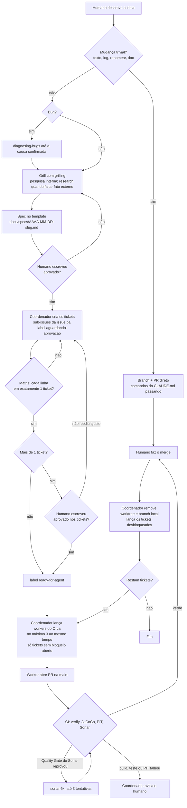
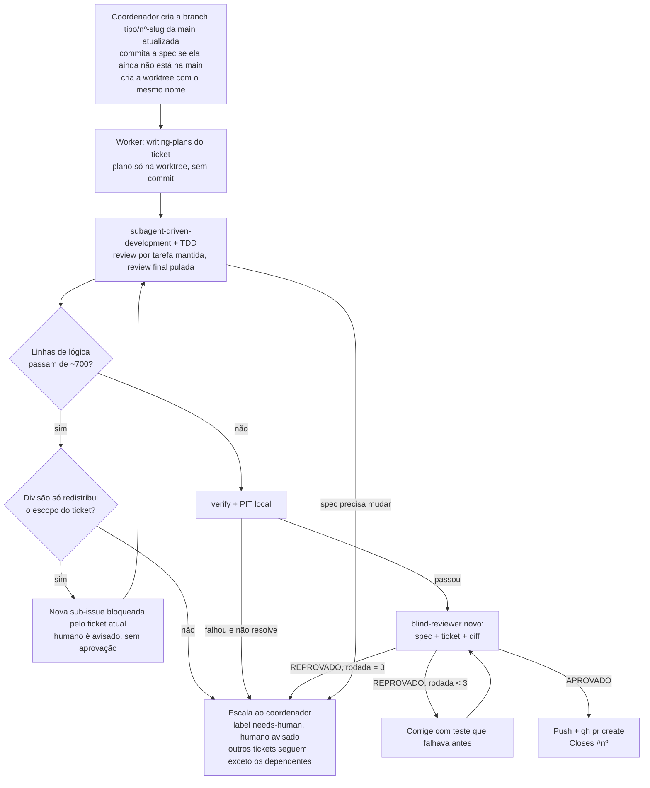

# Workflow de desenvolvimento dev-flow (substitui o spec-flow)
Status: aprovada (2026-11-25)

Issue: #15

## Problema e objetivo
No `spec-flow` atual o humano só participa da spec, a feature inteira sai num PR único (o `banco-catalogo-carrinho` teve 151 testes num PR), o plano não passa por ninguém e a sessão coordenadora acumula a feature toda. O `dev-flow` substitui o `spec-flow`. O humano participa da ideia, da spec e da validação dos tickets, e faz cada merge. O trabalho é quebrado em tickets (sub-issues do GitHub) de mais ou menos 500 linhas de lógica, cada um executado por um worker do Orca em sessão e worktree próprias, com review cega local antes de um PR direto para a `main`.

## Fora do escopo
- Código Java: nenhuma linha de `src/` muda.
- Alterar `ci.yml`, `sonar-fix.yml`, o agente `sonar-fix` ou a configuração do Sonar, JaCoCo e PIT. O Sonar continua rodando só no PR e o `sonar-fix` continua como está.
- Ferramenta nova de análise estática: o SonarCloud já cumpre esse papel.
- Configurações do GitHub feitas pelo humano no painel: branch protection na `main` (exigir PR e CI verde) e "Automatically delete head branches". A skill só as cita como pré-requisito.
- Alterar skills de terceiros (`to-tickets`, `grill-me`, `grilling`, `pr`, superpowers, `orchestration`, `orca-cli`) ou a `orquestrador-issues` global.
- Apagar skills do projeto que não fazem parte do workflow (as da coleção do Matt Pocock continuam).
- Mexer na documentação histórica (`docs/superpowers/`, `docs/plans/banco-catalogo-carrinho.md`, `docs/reviews/banco-catalogo-carrinho.md`).
- Rodar o fluxo novo numa feature real. A primeira feature depois do merge (por exemplo a #13) é o teste prático, fora desta spec.

## Fluxos

### Fluxo principal

### Execução de um ticket (dentro do worker)

## Design estrutural
N/A: a mudança é de skills, agentes e documentação, sem classes Java.

### Dependências novas
Nenhuma.

### Reuso
- Skills usadas sem alteração: `grilling` (chamada pelo humano via `grill-me`), `research`, `diagnosing-bugs`, `codebase-design`, `pr`, `orchestration`, `orca-cli`, `superpowers:writing-plans`, `superpowers:subagent-driven-development`, `superpowers:test-driven-development`.
- O `spec-template.md` do `spec-flow` vai para a `dev-flow` sem mudança de conteúdo.
- Regras da `to-tickets` aproveitadas no texto da `dev-flow` (sem chamar a skill, que tem `disable-model-invocation`): fatias verticais, prefactor primeiro, expand–contract para refactor largo, ticket sem trechos de código.
- Agentes `blind-reviewer` e `sonar-fix` do projeto.

## Decisões importantes
| # | Decisão | Opções consideradas | Escolha | Motivo | Reversível? |
|---|---------|---------------------|---------|--------|-------------|
| D1 | Nome da skill | manter `spec-flow`; criar `dev-flow` | `dev-flow`, apagando `spec-flow` | o fluxo vai da ideia ao merge, não só à spec | sim |
| D2 | Onde ficam os tickets | GitHub Issues; arquivos locais | sub-issues da issue pai, `blocked-by` nativo, no Projects Kanban, PR fecha com `Closes #N` | rastreabilidade issue ↔ PR nativa | sim |
| D3 | Aprovação e local da spec | PR só da spec; spec no PR do 1º ticket; spec no corpo da issue | aprovação no chat ("aprovado"); spec commitada em cada branch de ticket, imutável | não exige merge extra; cópias idênticas não conflitam no Git | sim |
| D4 | Destino dos PRs | direto na `main`; branch de feature | direto na `main`, um PR por ticket | PR pequeno, revisável; exige fatias verticais | caro |
| D5 | Execução | Orca só para paralelo; Orca para tudo | todo ticket é um worker do Orca, inclusive ticket único | uma regra só, sessão por ticket, coordenador leve | sim |
| D6 | Ticket dependente | esperar o merge; stacked PRs | esperar o merge do bloqueador | main sempre verde; stacked é frágil para agente | sim |
| D7 | Coordenador | mesma sessão do grill; sessão nova | mesma sessão, retomável por sessão nova lendo as issues | menos ação do humano | sim |
| D8 | Revisões | só subagent-driven; só blind-reviewer; ambos | reviews por tarefa do subagent-driven + 1 blind-reviewer por ticket; review final do subagent-driven pulada | as reviews por tarefa comparam com o plano; o blind-reviewer pega erro de interpretação da spec | sim |
| D9 | Onde roda a review cega | CI; local | local, no worker, antes do PR | não gasta assinatura a cada PR | sim |
| D10 | Tamanho do ticket | sem limite; ~500 linhas | ~500 linhas de lógica em `src/main/java`, sem testes, docs, json, yaml, sql; acima de ~700 divide; nunca enxugar código para caber | PR revisável sem induzir defeito | sim |
| D11 | Previsto × realizado | reviewer lê justificativas; reviewer só compara | reviewer compara ticket com diff; desvio sem mudança de comportamento = MENOR, comportamento fora dos CA = IMPORTANTE; justificativa só no PR | mantém a review cega | sim |
| D12 | Registro no repo | commitar plano e review; só no PR | plano só na worktree; relatório da review na descrição do PR | menos ruído; rastreabilidade no GitHub | sim |
| D13 | Recursos únicos em paralelo | deixar conflitar; reservar | coordenador reserva a versão de migration Flyway por ticket; arquivo compartilhado não reservável vira `blocked-by` | evita duas `V7` em PRs paralelos | sim |

## Regras de negócio
- RN01: Toda implementação (feature, bug, refactor, mudança de comportamento) passa pela `dev-flow`. A única exceção é mudança trivial (texto, log, renomear, ajuste de doc): branch + PR direto, com os comandos do CLAUDE.md passando.
- RN02: Bug passa primeiro por `diagnosing-bugs` até a causa confirmada. A spec registra a causa, e a matriz inclui o teste de regressão.
- RN03: O grill usa a skill `grilling`; `superpowers:brainstorming` não é usado. A pesquisa interna (código, schema, migrations) acontece dentro do grill; a `research` só entra quando falta um fato externo (documentação, API).
- RN04: A spec segue o `spec-template.md`, em `docs/specs/AAAA-MM-DD-<slug>.md`, com fluxogramas Mermaid (inclusive erros), tabela de decisões, CA testáveis e matriz de testes. As regras de Design estrutural do `spec-flow` continuam (solução simples primeiro, pattern só com comparação e aprovação explícita, código existente não é precedente).
- RN05: Nada é feito depois da spec sem o humano escrever "aprovado". Ao aprovar, `Status` vira `aprovada (data)`. A spec aprovada é imutável; se um worker precisar mudá-la, ele escala, o humano decide, e o coordenador aplica a mesma alteração em todas as branches de ticket abertas.
- RN06: Cada ticket é uma sub-issue da issue pai, com estas seções: contexto (spec e problema de origem), cenário atual, cenário desejado, rastreabilidade (RF/RN/CA e IDs da matriz que cobre), alterações previstas (classes e métodos), análise de impacto, dependências (`blocked-by` nativo), estimativa de linhas de lógica e, se criar schema, a versão de migration reservada. O ticket não leva trechos de código.
- RN07: Tickets são fatias verticais que funcionam e são testáveis sozinhas. Prefactor vem primeiro, como ticket próprio. Refactor largo segue expand–contract.
- RN08: Cada linha da matriz de testes pertence a exatamente um ticket. Linha sem ticket ou em dois tickets impede publicar os tickets.
- RN09: Os tickets são publicados com o label `aguardando-aprovacao`. Com mais de um ticket, os workers só começam depois que o humano escreve "aprovado" para os tickets; o label vira `ready-for-agent`. Com um ticket só, a aprovação da spec basta.
- RN10: Tamanho: estimativa de ~500 linhas de lógica por ticket, medidas com `git diff --numstat` contando só `src/main/java`. Acima de ~700, o worker para e o ticket é dividido. Nunca se remove ou comprime código para caber no limite.
- RN11: Divisão de ticket não precisa de aprovação, desde que a sub-issue nova só redistribua o escopo do ticket original (mesmos CA/RF, linhas da matriz e alterações previstas). A sub-issue nova fica bloqueada pelo ticket atual, e o humano é avisado. Divisão que traz escopo novo escala.
- RN12: Todo ticket é executado por um worker do Orca, em sessão e worktree próprias, inclusive quando a feature tem um ticket só. No máximo 3 workers ao mesmo tempo; os demais esperam na fila.
- RN13: Branch e worktree se chamam `<tipo>/<nº da sub-issue>-<slug-curto>`, com tipo `feat`, `fix` ou `refactor` (prefactor). São criadas a partir da `main` atualizada. Commits usam `Refs #<nº>`.
- RN14: Ticket bloqueado só começa depois do merge de todos os bloqueadores. Dois tickets que precisam do mesmo arquivo compartilhado não reservável (seed, `application.yaml`, seção de estrutura do CLAUDE.md) não são paralelos: um bloqueia o outro.
- RN15: Na criação dos tickets, o coordenador reserva uma versão de migration Flyway distinta para cada ticket que cria schema.
- RN16: O coordenador é a sessão do grill, da spec e dos tickets. Uma sessão nova consegue retomar a coordenação lendo só a issue pai e as sub-issues.
- RN17: Dentro do worker: `superpowers:writing-plans` para o plano do ticket (que fica só na worktree, sem commit); `superpowers:subagent-driven-development` com `superpowers:test-driven-development`; reviews por tarefa mantidas; review final do subagent-driven e `superpowers:finishing-a-development-branch` não rodam. Os testes saem das linhas da matriz atribuídas ao ticket e seguem `.claude/rules/testing.md`.
- RN18: Antes do PR, o worker roda `./mvnw clean verify` e o PIT localmente.
- RN19: Depois do verify e do PIT, o worker chama um `blind-reviewer` novo com spec, número do ticket e diff. BLOQUEANTE e IMPORTANTE são corrigidos, cada um com um teste que falhava antes, e um revisor novo é chamado. Limite de 3 rodadas.
- RN20: Com a review aprovada, o worker faz push da branch e abre o PR na `main` com `gh pr create`, usando a skill `pr`. A descrição traz: `Closes #<nº>`, link da spec, tabela RF/CA → testes, alterações realizadas (classes e métodos), previsto × realizado com justificativa de cada desvio, resumo da review cega (rodadas, achados, correções) e linhas de lógica medidas.
- RN21: O worker escala ao coordenador quando: a review reprova 3 rodadas, verify ou PIT não passam, a spec precisa mudar, ou a divisão traria escopo novo. O coordenador põe `needs-human` na issue, avisa o humano e deixa seguir os tickets que não dependem do travado.
- RN22: No CI, Quality Gate do Sonar reprovado aciona o `sonar-fix` (como hoje). Falha de build, teste ou PIT no CI não tem corretor automático: o coordenador avisa o humano.
- RN23: Nenhum agente faz merge. Depois do merge do humano, o coordenador remove a worktree e a branch local e lança os tickets desbloqueados.

## Regras do blind-reviewer (alterações)
- RV01: Entradas permitidas passam a incluir a issue do ticket (`gh issue view <nº>`), além da spec, do diff e do código. Plano, `docs/reviews/`, commits, descrição do PR e resumos continuam proibidos.
- RV02: Para um ticket, o escopo da review são os RF/CA e as linhas da matriz atribuídos ao ticket. O que a spec deixa para outros tickets não é achado.
- RV03: O reviewer compara as alterações previstas do ticket com o diff e lista os desvios. Desvio que não muda comportamento = MENOR. Comportamento fora dos CA do ticket = IMPORTANTE.
- RV04: O reviewer confere a regra de tamanho (RN10) e aponta como IMPORTANTE código visivelmente comprimido ou removido para caber no limite.

## Critérios de aceite (testáveis)
- CA01: Dado o repositório depois do PR, quando procuro `.claude/skills/dev-flow/SKILL.md`, então ele existe com frontmatter `name: dev-flow` e uma `description` que manda usar a skill em toda implementação (feature, bug, refactor, mudança de comportamento).
- CA02: Dado o PR, quando procuro `.claude/skills/spec-flow/`, então a pasta não existe, e `.claude/skills/dev-flow/spec-template.md` existe com o mesmo conteúdo do template antigo.
- CA03: Dado o repositório, quando rodo `grep -rn "spec-flow"` fora de `docs/` e `.git`, então não há resultado.
- CA04: Dada a `dev-flow`, quando leio o texto, então cada regra RN01 a RN23 aparece nele, e há os dois fluxogramas desta spec (principal e execução do ticket).
- CA05: Dada a `dev-flow`, quando leio a etapa de tickets, então ela traz o template de ticket com as seções da RN06 e as regras da RN07, sem chamar a skill `to-tickets`.
- CA06: Dada a `dev-flow`, quando leio a etapa de execução, então ela traz o prompt do worker com: número do ticket, spec, branch, escopo do ticket, os passos da RN17 a RN21 e a proibição de merge.
- CA07: Dado o `blind-reviewer.md`, quando leio as entradas e o procedimento, então RV01 a RV04 estão presentes e a lista de entradas proibidas continua sem plano, commits, descrição do PR e resumos.
- CA08: Dado o `CLAUDE.md`, quando leio a seção "Fluxo de trabalho", então ela diz que toda implementação usa a `dev-flow`, com a exceção de mudança trivial da RN01, e cita os pré-requisitos do GitHub (branch protection e auto-delete de branches).
- CA09: Dado o `CLAUDE.md`, quando leio o ponteiro do plano da demo, então ele diz que `docs/superpowers/` é histórico, do fluxo anterior.
- CA10: Dado o `.claude/rules/testing.md`, quando leio a tabela "Quem faz o quê", então os papéis são: spec (humano + grilling) define a matriz; coordenador distribui as linhas da matriz entre os tickets; worker escreve os testes antes do código; blind-reviewer não escreve testes; sonar-fix só cobre branch descoberto.
- CA11: Dado o PR, quando olho o diff, então só mudam `.claude/skills/dev-flow/`, `.claude/skills/spec-flow/` (removida), `.claude/agents/blind-reviewer.md`, `.claude/rules/testing.md`, `CLAUDE.md` e esta spec.

## Matriz de testes
Sem código, os "testes" são verificações feitas pelo blind-reviewer lendo os arquivos e rodando comandos.

| ID | CA/RN | Caminho exercitado | Técnica | Entrada → resultado esperado | Nível |
|---|---|---|---|---|---|
| V01 | CA01 | skill nova existe e é acionável | partição (existe) | ler o frontmatter → `name: dev-flow`, description cobre toda implementação | inspeção |
| V02 | CA02 | skill antiga removida, template preservado | estado | `ls .claude/skills/spec-flow` falha; `diff` do template com `git show origin/main:.claude/skills/spec-flow/spec-template.md` vazio | comando |
| V03 | CA03 | nenhuma referência órfã | partição (vazio) | `grep -rn "spec-flow" --exclude-dir=docs --exclude-dir=.git .` → vazio | comando |
| V04 | CA04 | todas as regras na skill | regra de negócio | conferir RN01 a RN23 uma a uma no texto | inspeção |
| V05 | CA04, RN10, RN11 | divisão de ticket, os dois lados | decisão | texto cobre a divisão que só redistribui (segue sem aprovação) e a que traz escopo novo (escala) | inspeção |
| V06 | CA04, RN09 | aprovação dos tickets, os dois lados | decisão | texto cobre 1 ticket (sem aprovação) e 2+ tickets (com aprovação) | inspeção |
| V07 | CA04, RN01 | exceção trivial, os dois lados | decisão | texto cobre o caminho trivial (PR direto) e o não trivial (fluxo completo) | inspeção |
| V08 | CA04, RN19, RN21 | limite da review | limite | rodada < 3 corrige e repete; rodada = 3 escala | inspeção |
| V09 | CA05 | template do ticket | regra de negócio | seções da RN06 presentes; sem chamada a `to-tickets` | inspeção |
| V10 | CA06 | prompt do worker | regra de negócio | prompt contém ticket, spec, branch, passos RN17 a RN21 e proibição de merge | inspeção |
| V11 | CA07 | blind-reviewer ajustado sem perder a cegueira | regra de negócio | RV01 a RV04 presentes; entradas proibidas intactas | inspeção |
| V12 | CA08, CA09 | CLAUDE.md | regra de negócio | seção "Fluxo de trabalho" e ponteiro histórico conforme CA08 e CA09 | inspeção |
| V13 | CA10 | testing.md | regra de negócio | tabela "Quem faz o quê" conforme CA10 | inspeção |
| V14 | CA11 | escopo do diff | partição (fora do escopo) | `git diff --name-only origin/main...HEAD` só lista os arquivos do CA11 | comando |

## Casos de borda e erros
- Ticket único: pula a aprovação de tickets, mas roda como worker do Orca (RN09, RN12).
- Orca indisponível (app fechado, runtime desconectado): o coordenador avisa o humano e não roda o ticket na própria sessão.
- Bloqueador travado em `needs-human`: os dependentes ficam esperando; os independentes seguem (RN21).
- Spec que precisa mudar com branches abertas: escala; a alteração aprovada é aplicada em todas as branches abertas (RN05).
- Dois tickets paralelos que criariam migration: versões reservadas distintas (RN15).
- Ticket que passa do tamanho no meio da execução: divisão (RN10, RN11).
- Sessão coordenadora perdida: retomada por sessão nova a partir das issues (RN16).
- Falha no CI que não é do Sonar: humano avisado, sem correção automática (RN22).

## Impacto
- Processo: muda como toda feature futura é feita. Mais PRs, menores; mais merges para o humano.
- Custo: até 3 sessões do Claude em paralelo (limite da assinatura).
- GitHub: labels novos `aguardando-aprovacao` e `ready-for-agent` (`needs-human` já é criado pelo `sonar-fix.yml`); uso de sub-issues e `blocked-by`.
- Pré-requisitos do humano: branch protection na `main` e "Automatically delete head branches".
- Banco, APIs, segurança e código Java: nenhum.

## Perguntas em aberto
- (nenhuma)
