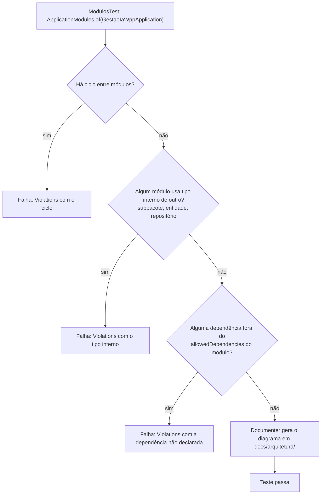
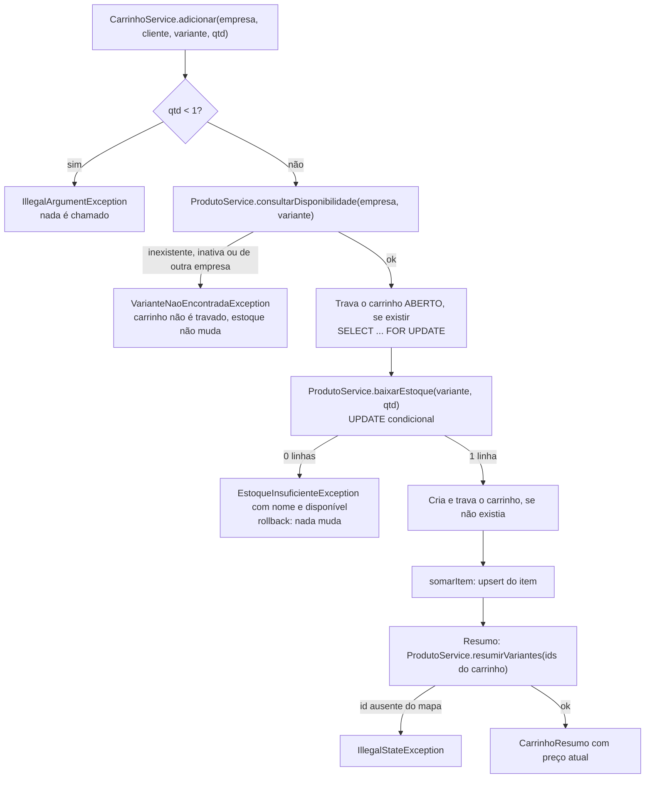
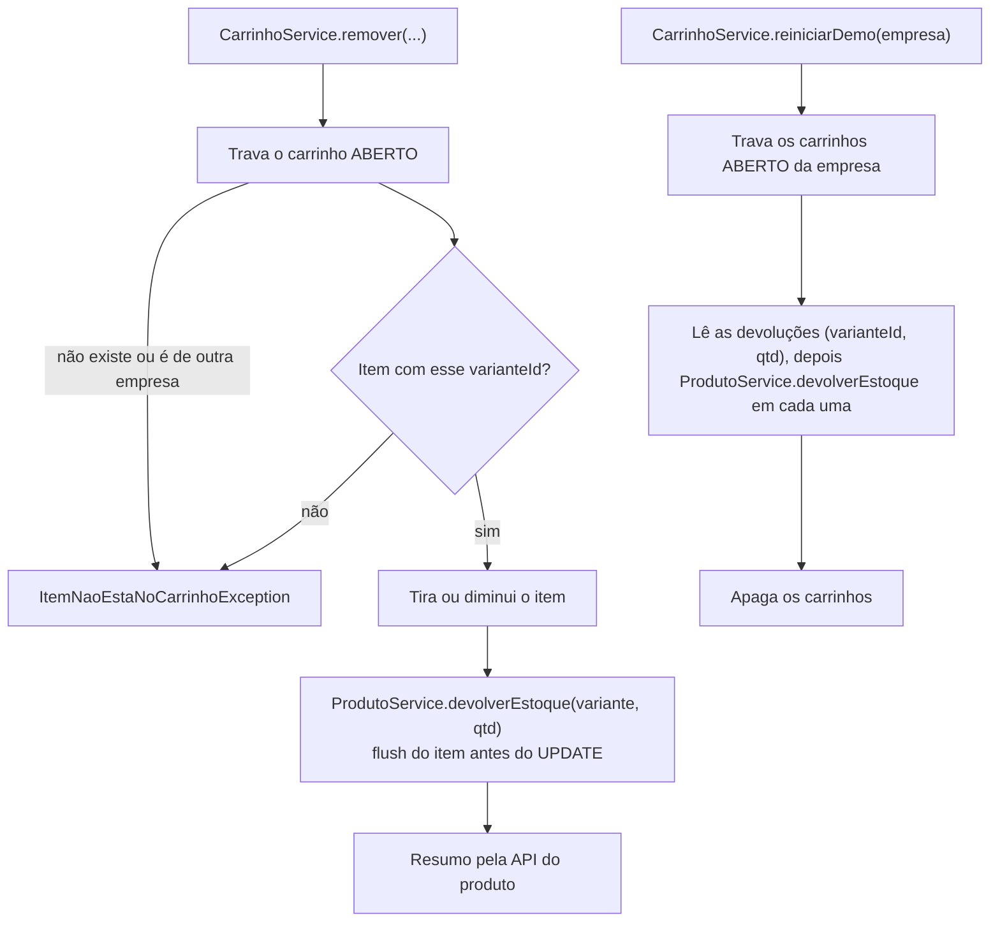
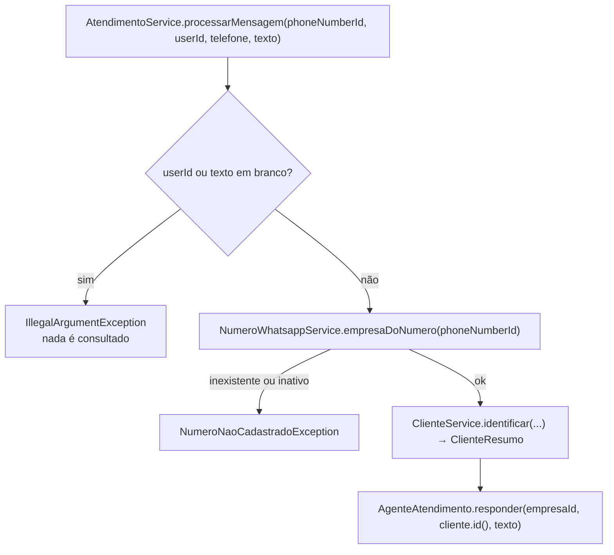
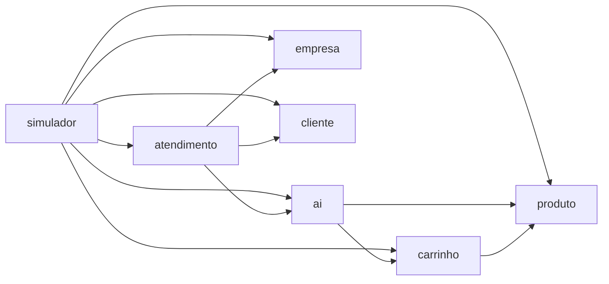
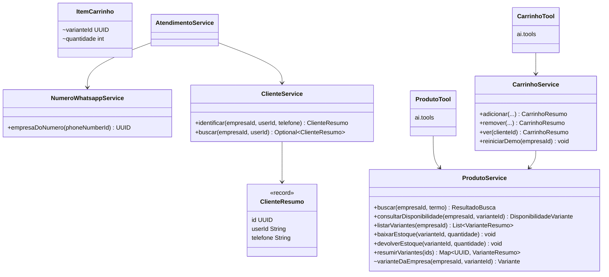
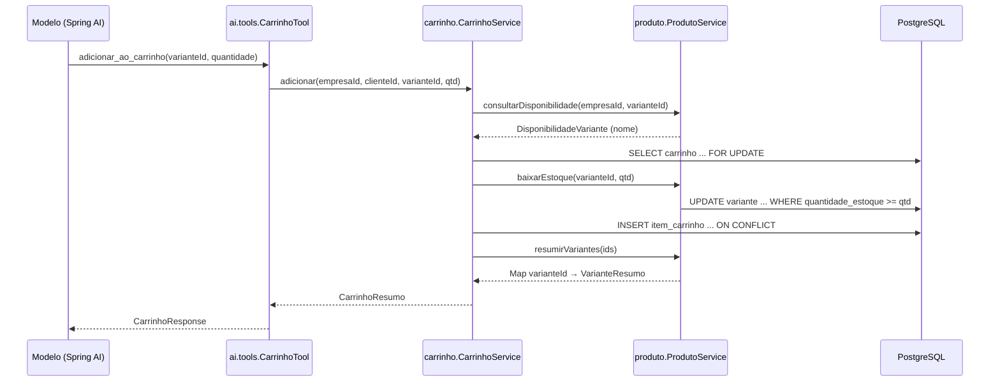

# Monolito modular com fronteiras garantidas
Status: aprovada (2026-11-26)

Issue: #16

## Problema e objetivo
O código já está separado por domínio (`empresa`, `cliente`, `produto`, `carrinho`, `atendimento`, `ai`, `simulador`), mas as fronteiras são só convenção:
- todas as classes são `public`;
- um módulo usa o repositório e as entidades de outro (`CarrinhoService` → `VarianteRepository`, `ItemCarrinho` → `@ManyToOne Variante`, `AtendimentoService` → `NumeroWhatsappRepository`);
- os domínios `produto` e `carrinho` dependem do `ai` (as tools importam `AgentTool`, `ContextoTool` e Spring AI), o que contraria a regra do `docs/contexto.md` de que "removendo a IA, o sistema de gestão continua funcional";
- nada impede uma dependência nova ou um ciclo.

Esta spec transforma o projeto num monolito modular de verdade. Cada módulo passa a ter uma API pública pequena, os domínios de gestão deixam de depender da IA, e um teste do Spring Modulith falha quando uma fronteira é violada. A arquitetura fica documentada no CLAUDE.md com o passo a passo para crescer (módulo novo, tool nova). **É um refactor puro: o comportamento observável não muda.**

## Fora do escopo
- **Eventos entre módulos** (`ApplicationEventPublisher`, `@ApplicationModuleListener`). A comunicação continua síncrona; eventos entram quando existir confirmação de pedido.
- **Nome do cliente.** As colunas `nome_perfil`, `nome` e `username` já existem na tabela `cliente`, mas não são mapeadas nem preenchidas. Ficam para a spec do webhook do WhatsApp (#3), que define de onde vem cada uma.
- **Expiração de carrinho abandonado** e a decisão em aberto nº 9 do `docs/contexto.md` (quando reservar estoque). Ficam na issue #18. O estoque continua reservado ao adicionar.
- **Separar as tools num módulo próprio** (`ferramentas`). Fica como evolução, com o gatilho descrito na seção "Crescimento".
- **Barrar import de `org.springframework.ai` nos domínios por teste.** O Modulith só verifica dependências entre módulos da aplicação; essa regra fica no CLAUDE.md e na review (D12).
- Qualquer mudança de schema, migration, endpoint, nome, parâmetro ou descrição de tool, prompt ou mensagem de erro.

## Fluxos

### Verificação da arquitetura (a cada `./mvnw test`)

### Adicionar ao carrinho (mesma ordem de hoje, agora pela API do produto)

### Remover do carrinho e reset (sem mudança de ordem)

### Mensagem de atendimento

## Design estrutural

### Módulos e dependências permitidas

| Módulo | `allowedDependencies` | O que é |
|---|---|---|
| `empresa` | nenhum | número de atendimento → empresa |
| `cliente` | nenhum | identificação do cliente por empresa e `user_id` |
| `produto` | nenhum | catálogo, busca, disponibilidade e estoque |
| `carrinho` | `produto` | carrinho persistido; reserva estoque pela API do produto |
| `ai` | `produto`, `carrinho` | agente, advisor, registry e as tools (`ai/tools/`) |
| `atendimento` | `empresa`, `cliente`, `ai` | entrada agnóstica de canal |
| `simulador` | todos os outros | interface da demo (REST + página) |

Regra fixa: `empresa`, `cliente`, `produto` e `carrinho` (os módulos de gestão) nunca dependem de `ai`, `atendimento` ou `simulador`. A lista do `ai` cresce com as tools novas (ver "Crescimento").

### Diagrama de classes (só o que é novo ou alterado)

### Sequência do fluxo principal (adicionar pela tool)

### Responsabilidades
| Classe/Interface | Responsabilidade (1 frase) | Camada | Nova ou existente |
|---|---|---|---|
| `empresa.NumeroWhatsappService` | Resolve o `phone_number_id` ativo para o id da empresa. | domínio (API do `empresa`) | nova |
| `cliente.ClienteResumo` | Dados públicos do cliente que saem do módulo. | domínio (API do `cliente`) | nova |
| `cliente.ClienteService` | Identifica e busca clientes; devolve `ClienteResumo`. | domínio | existente, assinatura muda |
| `produto.ProdutoService` | Passa a ser a única porta para estoque e dados de variante fora do `produto`. | domínio | existente, ganha 3 métodos |
| `carrinho.ItemCarrinho` | Guarda `varianteId` em vez da entidade `Variante`. | persistência | existente |
| `carrinho.CarrinhoService` | Mesma regra; estoque e dados de variante pela API do `produto`. | domínio | existente |
| `ai.tools.ProdutoTool`, `ai.tools.CarrinhoTool` | Adaptadores das tools, movidos dos domínios. | IA | movidas |
| `ai.tools.dto.*` | Respostas das tools, movidas de `produto/dto` e `carrinho/dto`. | IA | movidas |
| `ai.AgenteResponse`, `ai.IteracaoTurnoResponse`, `ai.ToolPedidaResponse` | Saem de `ai/dto` para a raiz (API do `ai`). | IA | movidas |
| `atendimento.AtendimentoService` | Usa `NumeroWhatsappService`; perde o método `empresaDoNumero`. | aplicação | existente |
| `simulador.SimuladorController` | Usa `NumeroWhatsappService` e `ClienteResumo`. | entrada | existente |
| `package-info.java` (7, um por módulo) | Declara `@ApplicationModule(allowedDependencies = ...)`. | arquitetura | novos |
| `ModulosTest` (teste, pacote raiz) | `verify()` dos módulos e geração do diagrama. | teste | novo |

Visibilidade depois da spec:
- **`public` na raiz do módulo (API):** serviços, records de entrada e saída, exceções, `AgenteAtendimento`, `AgentTool`, `ContextoTool` e os `*Response` do `ai`.
- ***package-private*:** entidades JPA (`Cliente`, `NumeroWhatsapp`, `Produto`, `Opcao`, `ValorOpcao`, `Variante`, `Carrinho`, `ItemCarrinho`), repositórios, `StatusCarrinho` se só o `carrinho` usar, e `ProdutoService.varianteDaEmpresa`.
- **Subpacotes** (`ai/tools`, `ai/tools/dto`): internos ao módulo pela regra do Modulith. Os tipos podem continuar `public` em Java, porque o `ToolRegistry` e o Spring AI precisam deles, mas outro módulo que os use falha no `verify()`.

Visibilidade dos construtores (RN17):
| Tipo | Classe | Construtor | Por quê |
|---|---|---|---|
| Entidades JPA | *package-private* | sem argumentos continua `protected`; os de fixture continuam *package-private* | O Hibernate exige construtor sem argumentos não `private` (instancia e cria proxies de *lazy loading*) |
| Repositórios | *package-private* | não tem (interface) | O Spring Data gera a implementação |
| Records | `public` | `public` (canônico) | A linguagem exige o canônico tão visível quanto o record |
| Exceções | `public` | sem mudança | Outros módulos capturam |
| Serviços que recebem repositório (`ProdutoService`, `CarrinhoService`, `ClienteService`, `NumeroWhatsappService`) | `public` | *package-private* | O construtor recebe tipo interno; só o próprio pacote (e seus fixtures de teste) monta o serviço, os outros módulos recebem o bean do Spring, que injeta por reflexão |
| Serviços e componentes que só recebem tipos públicos (`AtendimentoService`, `SimuladorController`, tools, `ToolRegistry`, `AgenteSpringAi`) | `public` | `public`, sem mudança | Não expõem tipo interno |
| Utilitários estáticos (`ContextoTool`) | `public` | `private`, sem mudança | Não devem ser instanciados |

### Patterns
Nenhum: solução simples atende. Os serviços existentes viram a API de cada módulo, sem fachada, porta ou adaptador novos. `@NamedInterface` não é usado (D08).

### Dependências novas
| Pacote (nome exato) | Versão | Para que serve aqui | Existe no registro? | Publisher | Alternativa sem dependência |
|---|---|---|---|---|---|
| `org.springframework.modulith:spring-modulith-bom` (import em `dependencyManagement`) | 2.2.0 | Fixa a versão dos artefatos do Modulith | sim (`dependency:get` ok em 2026-11-25) | Spring (`spring-projects/spring-modulith`, último push 2026-11-20) | versão explícita em cada artefato |
| `org.springframework.modulith:spring-modulith-api` (compile) | 2.2.0 (BOM) | Anotação `@ApplicationModule(allowedDependencies)` nos `package-info.java`; só anotações, sem comportamento em tempo de execução | sim | Spring | regra ArchUnit no teste (D07) |
| `org.springframework.modulith:spring-modulith-starter-test` (test) | 2.2.0 (BOM) | `ApplicationModules.verify()` e `Documenter` | sim; compilado contra Spring Boot 4.2.0 | Spring | ArchUnit puro, com as regras escritas à mão |

Advisories no GitHub (`gh api advisories ... affects=<artefato>@2.2.0`): lista vazia para os três, em 2026-11-25. O ArchUnit 1.5.1 chega transitivo pelo `spring-modulith-core` e não é usado direto pelo código.

### Reuso
- `ProdutoService.consultarDisponibilidade`: validação da variante e nome no `adicionar` (no lugar de `variantes.daEmpresa`).
- `VarianteRepository.baixarEstoque` e `devolverEstoque`: os mesmos `UPDATE` nativos, agora chamados só de dentro do `produto`.
- `VarianteResumo`: é o item do mapa de `resumirVariantes`, sem record novo.
- `CatalogoTeste` e `CarrinhoTeste`: os mesmos fixtures, com fábricas públicas que devolvem só tipos públicos.

## Decisões importantes
| # | Decisão | Opções consideradas | Escolha | Motivo | Reversível? |
|---|---------|---------------------|---------|--------|-------------|
| D01 | Quais são os módulos | por pacote de primeiro nível; agrupar gestão num módulo só | 7 módulos, um por pacote | Já é a separação atual; cada domínio cresce sozinho | sim |
| D02 | Como garantir as fronteiras | Spring Modulith; ArchUnit; só visibilidade Java | Modulith no teste + *package-private* | O compilador barra o acesso direto, o Modulith barra ciclos e dependências; é o padrão do ecossistema Spring | sim |
| D03 | Onde ficam as tools | `ai/tools/`; módulo `ferramentas`; nos domínios | `ai/tools/`, com DTOs em `ai/tools/dto/` | Inverte a dependência com o menor número de módulos; o formato da tool é contrato com o modelo, não com o domínio. Substitui a regra antiga "DTO da tool em `<domínio>/dto/`" | sim (mover pacote) |
| D04 | Carrinho e variante | `@ManyToOne Variante`; só `varianteId` | só `varianteId` (mesma coluna, sem migration; a FK fica no banco) | O carrinho deixa de depender do modelo JPA do catálogo | sim |
| D05 | API pública | tudo `public`; serviço + records + exceções | serviço + records + exceções; entidades e repositórios *package-private* | Interface pequena; mudanças internas não vazam | sim |
| D06 | Comunicação entre módulos | síncrona; eventos | síncrona | Nenhum fluxo pede assincronia hoje | sim |
| D07 | Direção das dependências | `allowedDependencies`; regra ArchUnit; aceitar só ciclos | `allowedDependencies` em `package-info.java`, com `spring-modulith-api` no escopo de compilação | Sem isso, `cliente → ai` passaria (não forma ciclo); a regra fica no próprio módulo e aparece no diagrama | sim |
| D08 | `ai/dto` usado por outros módulos | mover para a raiz; `@NamedInterface` | mover para a raiz | Sem anotação extra; `@NamedInterface` fica para quando um subpacote precisar mesmo ser exposto | sim |
| D09 | O que `ClienteService` devolve | `UUID`; `ClienteResumo` | `ClienteResumo(id, userId, telefone)` | Tipagem (não confunde com o id da empresa) e evolução sem mudar assinatura; só os campos que a entidade mapeia hoje | sim |
| D10 | API de estoque do produto | `reservarEstoque` único; `consultarDisponibilidade` + `baixarEstoque` | reaproveitar `consultarDisponibilidade` e criar `baixarEstoque`, `devolverEstoque`, `resumirVariantes` | Mantém a ordem atual (validar, travar carrinho, baixar) e os testes que dependem dela | sim |
| D11 | Testes existentes que fazem `verify` no repositório de outro módulo | apagar e reescrever; trocar o alvo | mesma afirmação, alvo trocado para a API pública (tabela abaixo) | Não enfraquece nenhum teste e segue "mock só nas fronteiras" | sim |
| D12 | Barrar `org.springframework.ai` nos domínios | ArchUnit no teste; regra escrita | regra no CLAUDE.md + review | Depois do D03 nenhum domínio usa Spring AI, e o Modulith não cobre bibliotecas externas; uma regra ArchUnit fica como evolução se a regra for violada | sim |
| D13 | Diagrama | não gerar; gerar em `target/`; versionar | `Documenter` em todo `./mvnw test`, gravando em `docs/arquitetura/` | O diagrama nunca fica desatualizado e a mudança aparece no diff do PR | sim |
| D14 | Quando documentar no CLAUDE.md | PR trivial agora; último ticket | último ticket, junto com o `ModulosTest` | Só documenta a regra quando ela passa a valer; evita conflito no arquivo compartilhado | sim |
| D15 | Construtor dos serviços que recebem repositório | `public`; *package-private* | *package-private* (RN17) | O construtor recebe tipo interno; a assinatura passa a dizer que só o módulo monta o serviço. O Spring injeta por reflexão | sim |

## Regras de negócio
- RN01: Os módulos são os 7 pacotes de primeiro nível sob `app.gestaoIAWpp`. Não há ciclo entre eles.
- RN02: Cada módulo declara em `package-info.java` o `@ApplicationModule(allowedDependencies = ...)` da tabela "Módulos e dependências permitidas". Uma dependência fora da lista falha no `ModulosTest`.
- RN03: A API de um módulo é o conjunto de tipos `public` na raiz do pacote do módulo. Entidades JPA e repositórios são *package-private*. Subpacotes são internos.
- RN04: `empresa`, `cliente`, `produto` e `carrinho` não importam nada de `app.gestaoIAWpp.ai`, `app.gestaoIAWpp.atendimento`, `app.gestaoIAWpp.simulador` nem `org.springframework.ai`.
- RN05: Comportamento observável inalterado: nomes, parâmetros, descrições e respostas das 5 tools; endpoints e JSON do simulador; todas as mensagens de erro; as regras RN01 a RN14 da spec `2026-11-24-banco-catalogo-carrinho.md`.
- RN06: `ProdutoService.baixarEstoque(varianteId, quantidade)` é o mesmo `UPDATE` condicional de hoje, sem ler o estoque em Java antes. Com 0 linhas afetadas, lança `EstoqueInsuficienteException(varianteId, nome, solicitado, disponível)`, com nome e disponível lidos depois da falha, como hoje.
- RN07: `baixarEstoque` e `devolverEstoque` têm `@Transactional` de escrita explícito (não herdam o `readOnly = true` da classe). Dentro de uma transação, participam dela; fora, abrem uma de escrita.
- RN08: `ProdutoService.resumirVariantes(ids)` devolve `Map<UUID, VarianteResumo>` com o preço atual. Não filtra variante inativa nem produto inativo, como o resumo atual. Ids inexistentes ficam fora do mapa.
- RN09: No resumo do carrinho, um item cuja variante não veio no mapa lança `IllegalStateException("Variante <id> do carrinho não existe.")`. A FK impede isso no banco; a regra só evita um `NullPointerException` silencioso.
- RN10: A ordem de `adicionar` é: validar a quantidade, validar a variante (`consultarDisponibilidade`), travar o carrinho existente, baixar o estoque, criar e travar o carrinho se ele não existia, gravar o item, resumir. Quantidade inválida e variante inválida não travam o carrinho nem tocam o estoque.
- RN11: `ClienteService.identificar` devolve `ClienteResumo(id, userId, telefone)` e `buscar` devolve `Optional<ClienteResumo>`.
- RN12: `NumeroWhatsappService.empresaDoNumero(phoneNumberId)` devolve o id da empresa do número ativo ou lança `NumeroNaoCadastradoException`. `AtendimentoService` deixa de ter `empresaDoNumero`, e o `SimuladorController` passa a chamar o serviço do `empresa`.
- RN13: As tools ficam em `ai/tools/` e os DTOs delas em `ai/tools/dto/`. `AgenteResponse`, `IteracaoTurnoResponse` e `ToolPedidaResponse` ficam na raiz de `ai`.
- RN14: Testes existentes: nenhuma afirmação é removida ou afrouxada. Quando o alvo de um `verify` ou de um mock virou interno a outro módulo, a mesma afirmação (mesmos argumentos e contagem) passa para o método equivalente da API pública, conforme a tabela "Testes existentes adaptados". Testes de uma classe movida vão para o pacote espelho.
- RN15: O `ModulosTest` é um teste unitário (`*Test`, sem contexto Spring e sem banco). Ele roda o `verify()` e o `Documenter`, que grava o diagrama de visão geral dos módulos em `docs/arquitetura/`.
- RN16: O CLAUDE.md ganha a seção "Arquitetura: monolito modular" (módulos, tabela de dependências, o que é API, regra RN04, o `ModulosTest`) e os guias "Como criar um módulo", "Como criar uma tool" e "Quando evoluir a estrutura" (seção "Crescimento"). A seção "Estrutura da demo" é atualizada para os pacotes novos.
- RN17: O construtor de todo serviço que recebe um repositório (`ProdutoService`, `CarrinhoService`, `ClienteService`, `NumeroWhatsappService`) é *package-private*. Nenhum construtor de entidade é `private`: o sem argumentos continua `protected`. Os demais construtores seguem a tabela "Visibilidade dos construtores".

## Crescimento
Conteúdo que entra no CLAUDE.md (RN16), para a aplicação crescer sem perder as fronteiras.

**Criar um módulo** (ex.: `pedido`, `conversa`, `atendente`):
1. Pacote de primeiro nível sob `app.gestaoIAWpp`.
2. `package-info.java` com `@ApplicationModule(allowedDependencies = {...})`, listando só o necessário.
3. API na raiz (serviço, records, exceções); entidades e repositórios *package-private*.
4. Uma linha nova na tabela de dependências do CLAUDE.md.
5. `./mvnw test`: o `ModulosTest` valida e regenera o diagrama, que vai no mesmo PR.

**Criar uma tool:**
1. Classe `@Component` em `ai/tools/`, implementando `AgentTool`, com `@Order`; DTOs em `ai/tools/dto/`.
2. A tool só delega à API pública do domínio. Nenhuma regra de negócio fica na tool.
3. Se o domínio ainda não está no `allowedDependencies` do `ai`, acrescentá-lo.

**Quando evoluir a estrutura:**
| Sinal | Ação |
|---|---|
| Um módulo precisa expor um subpacote | `@NamedInterface` no subpacote (a `spring-modulith-api` já está no escopo de compilação) |
| O `ai` passa a depender de muitos domínios | Separar as tools num módulo `ferramentas` que depende de `ai` e dos domínios |
| Surge um fluxo assíncrono (ex.: pedido confirmado → notificar) | Eventos do Modulith (`@ApplicationModuleListener`), com o módulo que reage dependendo só do evento |
| Um módulo fica grande demais para entender de uma vez | Dividir em submódulos, cada um com a sua API |
| Um domínio passa a importar `org.springframework.ai` | Regra ArchUnit no `ModulosTest` (D12) |

## Critérios de aceite (testáveis)
- CA01: Dado o código da `main` depois da spec, quando roda `./mvnw test`, então o `ModulosTest` passa (sem ciclo, sem tipo interno usado de fora, sem dependência não declarada).
- CA02: Dado um módulo que depende de outro fora do seu `allowedDependencies`, quando o `verify()` roda, então ele falha apontando a dependência.
- CA03: Dado o `./mvnw test`, quando o `ModulosTest` termina, então `docs/arquitetura/` contém o diagrama de visão geral com os 7 módulos.
- CA04: Dado o código depois da spec, quando se procura por `import app.gestaoIAWpp.ai`, `import app.gestaoIAWpp.atendimento`, `import app.gestaoIAWpp.simulador` ou `import org.springframework.ai` em `empresa/`, `cliente/`, `produto/` e `carrinho/` (main), então não há nenhum resultado.
- CA05: Dado que o pacote `ai` é removido, quando os módulos `empresa`, `cliente`, `produto` e `carrinho` são compilados, então compilam, porque nenhuma classe deles referencia `ai` (verificado pelo CA04 e pelo `allowedDependencies`).
- CA06: Dado `ProdutoService.baixarEstoque` chamado fora de transação com saldo suficiente, quando executa, então o estoque baixa (não falha por transação somente leitura).
- CA07: Dado saldo insuficiente, quando `baixarEstoque` executa, então lança `EstoqueInsuficienteException` com o nome da variante, a quantidade pedida e a disponível, e o estoque não muda.
- CA08: Dado `ProdutoService.devolverEstoque` chamado fora de transação, quando executa, então o estoque sobe.
- CA09: Dado um carrinho com item de variante desativada, quando o resumo é montado, então o item aparece com o preço atual (como hoje).
- CA10: Dado um id de variante inexistente, quando `resumirVariantes` executa, então o id não aparece no mapa; e no resumo do carrinho, esse caso lança `IllegalStateException`.
- CA11: Dado um número ativo, quando `NumeroWhatsappService.empresaDoNumero` executa, então devolve a empresa; dado um número inexistente ou inativo, lança `NumeroNaoCadastradoException`.
- CA12: Dado o mesmo cliente identificado duas vezes, quando `ClienteService.identificar` executa, então devolve dois `ClienteResumo` com o mesmo `id`, `userId` e `telefone`.
- CA13: Dado todos os testes que existiam antes da spec, quando a spec termina, então cada um ainda existe (no pacote original ou no espelho da classe movida) e cada afirmação está igual ou trocada conforme a tabela "Testes existentes adaptados".
- CA14: Dado o CLAUDE.md, quando a spec termina, então ele tem as seções da RN16 e a "Estrutura da demo" cita `ai/tools/`, `ClienteResumo` e `NumeroWhatsappService`.
- CA15: Dado os serviços da RN17, quando o Spring sobe o contexto (`GestaoIaWppApplicationIT`), então todos os beans são criados com o construtor *package-private*; e um teste de outro módulo só consegue montar esses serviços pelas fábricas dos fixtures.

## Matriz de testes
| ID | CA/RN | Caminho exercitado | Técnica (partição/limite/decisão/erro/estado) | Entrada → resultado esperado | Nível (unit/integração/e2e) |
|---|---|---|---|---|---|
| M01 | CA01, RN01, RN02, RN03 | Módulos reais respeitam as regras | partição (válido) | `ApplicationModules.of(GestaoIaWppApplication.class).verify()` → sem exceção | unit (`ModulosTest`) |
| M02 | CA02, RN02 | Dependência fora do `allowedDependencies` | erro | fixture de teste com dois módulos, um dependendo do outro sem declarar → `verify()` lança `Violations` | unit (`ModulosTest`) |
| M03 | CA03, RN15 | Diagrama gerado | partição (válido) | `Documenter` roda → arquivo de visão geral em `docs/arquitetura/` contendo os 7 nomes de módulo | unit (`ModulosTest`) |
| M04 | CA06, RN06, RN07 | `baixarEstoque` fora de transação | decisão (sem transação ativa) | estoque 2, baixar 1 sem `@Transactional` no teste → saldo 1 | integração (`ProdutoServiceIT`) |
| M05 | CA07, RN06 | `baixarEstoque` sem saldo | erro | estoque 1, baixar 2 → `EstoqueInsuficienteException` com nome, 2 e 1; saldo 1 | unit (`ProdutoServiceTest`) |
| M06 | CA06, RN06 | `baixarEstoque` com saldo | partição (válido) | estoque 2, baixar 2 → sem exceção, `UPDATE` com 2 | unit (`ProdutoServiceTest`) |
| M07 | CA08, RN07 | `devolverEstoque` fora de transação | decisão (sem transação ativa) | estoque 1, devolver 2 sem `@Transactional` no teste → saldo 3 | integração (`ProdutoServiceIT`) |
| M08 | CA09, RN08 | `resumirVariantes` com variante inativa | partição (inativa) | id de variante desativada → presente no mapa, com o preço atual | unit (`ProdutoServiceTest`) |
| M09 | CA10, RN08 | `resumirVariantes` com id inexistente | partição (inexistente) | um id válido e um inexistente → mapa só com o válido | unit (`ProdutoServiceTest`) |
| M10 | CA10, RN09 | Resumo do carrinho sem a variante no mapa | erro | item cujo id não volta de `resumirVariantes` → `IllegalStateException("Variante <id> do carrinho não existe.")` | unit (`CarrinhoServiceTest`) |
| M11 | CA11, RN12 | Número ativo | partição (válido) | número ativo → id da empresa (movido de `AtendimentoServiceTest.deveDevolverEmpresa_quandoNumeroAtivo`) | unit (`NumeroWhatsappServiceTest`) |
| M12 | CA11, RN12 | Número inexistente ou inativo | erro | `"x"` → `NumeroNaoCadastradoException` (movido de `deveLancar_quandoEmpresaDoNumeroNaoCadastrado`) | unit (`NumeroWhatsappServiceTest`) |
| M13 | CA12, RN11 | `identificar` devolve `ClienteResumo` | estado (criar, depois reaproveitar) | `identificar` duas vezes → mesmos `id`, `userId` e `telefone` (adapta o T08 do `ClienteServiceIT`) | integração (`ClienteServiceIT`) |
| M14 | CA04, RN04 | Domínios sem import de IA, atendimento e simulador | partição (proibido) | busca por imports proibidos em `empresa/`, `cliente/`, `produto/` e `carrinho/` → nenhum | review (blind-reviewer, com `grep`) |
| M15 | CA13, RN14 | Testes existentes preservados | estado | cada linha da tabela "Testes existentes adaptados" conferida no diff → afirmação igual | review (blind-reviewer) |
| M16 | CA14, RN16 | CLAUDE.md atualizado | partição (válido) | seções da RN16 presentes | review (blind-reviewer) |
| M17 | CA15, RN17 | Spring injeta pelo construtor *package-private* | partição (válido) | contexto sobe com os 4 serviços da RN17 (o `contextLoads` existente do `GestaoIaWppApplicationIT` cobre; nenhum teste novo) e o diff mostra os 4 construtores sem modificador | integração (existente) + review |

Os caminhos de comportamento que não mudam (RN05, RN10: ordem de travas, concorrência T04, rollback T07, reset concorrente T21, remover parcial T17, as 5 tools, os endpoints) continuam cobertos pelos testes existentes, que precisam passar sem mudar a afirmação.

### Testes existentes adaptados
Só a montagem ou o alvo mudam; a afirmação fica igual.

| Arquivo (antes → depois) | Teste(s) | Antes | Depois |
|---|---|---|---|
| `carrinho/CarrinhoServiceTest` | `deveDiminuirItemEDevolver_quandoRemoveMenosQueOItem`, `deveTirarItemEDevolverTudo_quandoRemoveAQuantidadeDoItem`, `deveTirarItemEDevolverTudo_quandoRemoveSemQuantidade`, `deveAceitarRemover_quandoQuantidadeUm` | `verify(variantes).devolverEstoque(pretaM, n)` | `verify(produtos).devolverEstoque(pretaM, n)` |
| `carrinho/CarrinhoServiceTest` | `deveAceitarAdicionar_quandoQuantidadeUm` | `verify(variantes).baixarEstoque(pretaM, 1)` | `verify(produtos).baixarEstoque(pretaM, 1)` |
| `carrinho/CarrinhoServiceTest` | `deveRecusarRemover_quandoVarianteNaoEstaNoCarrinho`, `..._quandoClienteNaoTemCarrinhoAberto`, `..._quandoCarrinhoEDeOutraEmpresa` | `verify(variantes, never()).devolverEstoque(any(), anyInt())` | `verify(produtos, never()).devolverEstoque(any(), anyInt())` |
| `carrinho/CarrinhoServiceTest` | `deveRecusarAdicionar_quandoVarianteNaoEncontrada` | `verify(variantes, never()).baixarEstoque(any(), anyInt())` | `verify(produtos, never()).baixarEstoque(any(), anyInt())` |
| `carrinho/CarrinhoServiceTest` | `deveRecusarAdicionar_quandoQuantidadeZero`, `deveRecusarRemover_quandoQuantidadeZero` | `verifyNoInteractions(variantes, carrinhos)` | `verifyNoInteractions(produtos, carrinhos)` |
| `ai/ToolsAgenteTest` → `ai/tools/ToolsAgenteTest` | `adicionarUsaClienteDoContextoEBaixaEstoque`, `removerSemQuantidadeRemoveTudo` | `verify(variantes).baixarEstoque/devolverEstoque(pretaM, 2)` | `verify(produtos).baixarEstoque/devolverEstoque(pretaM, 2)` |
| `ai/ToolsAgenteTest` → `ai/tools/ToolsAgenteTest` | `quantidadeZeroLancaSemBaixa`, `quantidadeAusenteLancaSemBaixa`, `semClienteNoContextoFalhaComMensagemClara`, `callbackComFormatoInvalidoLancaToolExecutionException` | `verify(variantes, never()).baixarEstoque(any(), anyInt())` | `verify(produtos, never()).baixarEstoque(any(), anyInt())` |
| `ai/AgenteSpringAiTest` | `paraNoLimiteDeIteracoesComFallback`, `entradaComFormatoInvalidoVoltaAoModeloComoErro` | `verify(variantes, times(4) / never()).baixarEstoque(...)` | `verify(produtos, times(4) / never()).baixarEstoque(...)` |
| `ai/CaracterizacaoToolsTest` → `ai/tools/CaracterizacaoToolsTest` | todos | montagem com `VarianteRepository` | montagem pelas fábricas do `CatalogoTeste`/`CarrinhoTeste`; asserções iguais |
| `atendimento/AtendimentoServiceTest` | `deveDevolverEmpresa_quandoNumeroAtivo`, `deveLancar_quandoEmpresaDoNumeroNaoCadastrado` | chamam `service.empresaDoNumero` | movidos para `empresa/NumeroWhatsappServiceTest` (M11, M12), com as mesmas asserções |
| `atendimento/AtendimentoServiceTest` | `deveIdentificarClienteEPassarIdsAoAgente_quandoNumeroValido`, `deveAceitarTelefoneNulo_quandoCanalNaoInformaTelefone`, `deveLancarSemConsultarRepositorio_quandoUserIdOuTextoEmBranco` | mock de `NumeroWhatsappRepository` e de `Cliente` | mock de `NumeroWhatsappService` e `ClienteResumo` real; `verifyNoInteractions(numeros, clientes, agente)` com `numeros` = o serviço |
| `simulador/SimuladorControllerTest` | `getEstadoRetornaCarrinhoEEstoque`, `getEstadoRetornaCarrinhoVazio_quandoClienteNaoExiste`, `userIdDoSimulador_cobreLimitesEEmBranco` | `atendimento.empresaDoNumero(...)`, mock de `Cliente` | `numeros.empresaDoNumero(...)` (o `NumeroWhatsappService`), `ClienteResumo` real; o `verify(..., never()).empresaDoNumero` passa para o serviço do `empresa` |
| `cliente/ClienteServiceIT` | os 3 testes | recebem `Cliente` | recebem `ClienteResumo`; mesmas asserções sobre `id`, `userId`, `telefone` e exceção |

Montagem nos testes de `carrinho` e `ai`: o `ProdutoService` é o real montado pelo `CatalogoTeste` (que mocka os repositórios dentro do próprio pacote `produto`), envolvido em `Mockito.spy`, para os `verify` acima e para os resumos continuarem com nome e preço reais. `CarrinhoTeste.repositorio(VarianteRepository)` vira uma fábrica que não expõe tipos internos do `produto`.

## Casos de borda e erros
- **Concorrência na última unidade:** continua sendo o `UPDATE` condicional (T04, sem mudança). `baixarEstoque` não lê o saldo antes de atualizar (RN06).
- **Transação somente leitura:** `ProdutoService` tem `readOnly = true` na classe; os métodos de escrita precisam do próprio `@Transactional` (RN07, M04, M07).
- **Contexto de persistência limpo:** as queries nativas continuam com `clearAutomatically`. O `CarrinhoService` continua lendo o carrinho de novo depois delas; o resumo pega o nome e o preço por `resumirVariantes`, depois da última escrita.
- **N+1 no resumo:** `resumirVariantes` busca todos os ids numa consulta, não uma por item.
- **Variante desativada no carrinho:** continua aparecendo no resumo (RN08, M08).
- **Ordem das travas:** carrinho primeiro, depois variante, sem mudança (RN10).
- **Entidades *package-private*:** o Hibernate e o Spring Data aceitam entidade e repositório *package-private*; o construtor sem argumentos continua `protected`.

## Impacto
- **Banco/migrações:** nenhum. A coluna `item_carrinho.variante_id` e a FK continuam; só o mapeamento JPA muda.
- **APIs públicas Java:** `ClienteService` (retorno), `AtendimentoService` (perde `empresaDoNumero`), `ProdutoService` (3 métodos novos; `varianteDaEmpresa` deixa de ser público), pacotes de `ProdutoTool`, `CarrinhoTool` e dos DTOs.
- **APIs externas:** nenhuma (tools, endpoints e JSON iguais).
- **Build:** `spring-modulith-bom` no `dependencyManagement`, `spring-modulith-api` (compile) e `spring-modulith-starter-test` (test). Configuração do JaCoCo, PIT e Sonar não muda.
- **Documentação:** CLAUDE.md (RN16) e `docs/arquitetura/` (gerado). A memória local do agente com a regra "DTO da tool em `<domínio>/dto/`" é atualizada pelo coordenador para a regra D03.
- **Performance:** o resumo do carrinho passa de *lazy loading* por item para uma consulta em lote (igual ou melhor).

## Perguntas em aberto
- (nenhuma)
